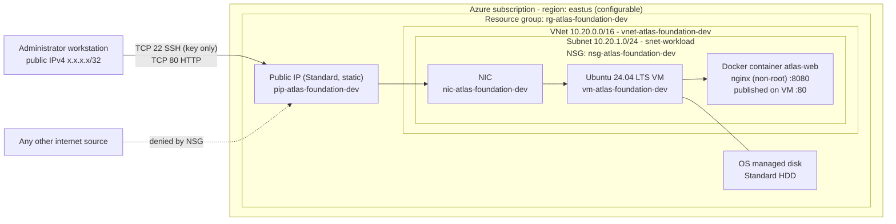

# Atlas Platform Foundation

Milestone 1 of the **Atlas** cloud engineering portfolio: a small, secure, fully
reproducible Azure landing spot for a containerised web service, built with
**Terraform**, **Azure networking**, **Ubuntu Linux**, **cloud-init** and **Docker**.

**Milestone 2 (in progress)** adds the deployment engine: pull-request CI, GitHub
Actions OIDC to Azure (no stored secrets), Terraform remote state in Azure Storage,
an approved plan/apply workflow with automatic validation and cleanup. **First live run
passed on 2026-11-14** (plan, approval, apply, validation, destroy); failure cleanup, the
Destroy workflow, auto-shutdown and complete teardown are not live-tested yet. See
[`docs/milestone-2.md`](docs/milestone-2.md) and [section 17](#17-milestone-2-deployment-engine).

**Milestone 3 (implemented offline, in review)** deploys and tests a real support-ticket
app, the Atlas Service Desk demo (fictional data only), on this infrastructure:
- the exact GHCR image digest is planned, approved and checked in the VM;
- independent API and browser tests run, including a deliberate fault build they must catch;
- application and cleanup results are reported separately;
- lifetime gates account for the 02:00 UK auto-shutdown and the 03:30 UTC Destroy;
- an owner inspection window with the URL delivered privately;
- guarded failure-cleanup and an hourly expiry sweep that protect on uncertainty.

**No Milestone 3 live run yet.** See [`docs/milestone-3.md`](docs/milestone-3.md),
[`docs/milestone-3-design.md`](docs/milestone-3-design.md) and [section 18](#18-milestone-3-support-ticket-application).

> **Status:** deployed to Azure (East US, `Standard_B2ats_v2`) on 2026-11-13 from a
> reviewed saved plan, validated, then destroyed. Public, in-VM (Azure Run Command)
> and network-restriction checks passed after two validation-script fixes; results,
> limitations and anything untested are in [`docs/validation-log.md`](docs/validation-log.md)
> section 4, with sanitised output in [`docs/evidence/2026-11-13-deployment/`](docs/evidence/2026-11-13-deployment/).
> Latest offline run (2026-11-16, Milestone 3 Stages 1-4): `validate.sh` (`REQUIRE_ALL=1`) 19 passed, 0 failed, 0 skipped; `terraform test` 23/23; script tests 158/158 - see
> [`docs/validation-log.md`](docs/validation-log.md) sections 12-15 (section 10 for the 2026-11-15 masking run).
>
> Latest live run (2026-11-14, Milestone 2 Deploy run [43588089749](https://github.com/Shayze01/atlas-platform-foundation/actions/runs/43588089749)):
> 11 resources applied from the reviewed plan, public 5/5, in-VM 10/10, blocked 3/3,
> 11 destroyed with the workload group kept empty - see
> [`docs/validation-log.md`](docs/validation-log.md) section 9 and
> [`docs/evidence/2026-11-14-m2-live-run/`](docs/evidence/2026-11-14-m2-live-run/).
> **Not live-tested:** failure cleanup, deliberate plan hash-mismatch rejection,
> `destroy.yml` (manual/nightly) and the `azure-destroy` credential, the 02:00 auto-shutdown
> firing, concurrency/lock recovery, lifecycle expiry, planning against
> existing resources, `teardown.sh`. Costs are estimates pending billing data.
>
> **Log masking (section 10):** the tenant, subscription and client IDs and the storage
> account name are GitHub variables, not secrets. Each Azure job masks them from its
> second step onwards; the first step's `env:` header still shows them once. The
> sanitiser masks only values that match its patterns. Neither change has been seen in
> a live run log yet.

---

## Contents

1. [Problem and scope](#1-problem-and-scope)
2. [Architecture](#2-architecture)
3. [Repository layout](#3-repository-layout)
4. [Prerequisites](#4-prerequisites)
5. [Authenticate with Azure CLI](#5-authenticate-with-azure-cli)
6. [Configure variables](#6-configure-variables)
7. [Validate, plan and apply](#7-validate-plan-and-apply)
8. [Connectivity checks](#8-connectivity-checks)
9. [Destroy and verify cleanup](#9-destroy-and-verify-cleanup)
10. [Resources and network rules explained](#10-resources-and-network-rules-explained)
11. [Troubleshooting](#11-troubleshooting)
12. [Evidence screenshots](#12-evidence-screenshots)
13. [Cost](#13-cost)
14. [Terraform state (local) and its limitations](#14-terraform-state-local-and-its-limitations)
15. [Offline validation and tests](#15-offline-validation-and-tests)
16. [Security notes and known limitations](#16-security-notes-and-known-limitations)
17. [Milestone 2: deployment engine](#17-milestone-2-deployment-engine)
18. [Milestone 3: support-ticket application](#18-milestone-3-support-ticket-application)

---

## 1. Problem and scope

**Problem.** Clicking resources together in the Azure portal is slow, hard to
repeat and easy to get wrong (for example, leaving SSH open to the whole
internet). An infrastructure engineer should be able to rebuild an environment
from code, secure by default, and tear it down again to control cost.

**This milestone delivers:**

- A dedicated resource group, one virtual network (VNet) and one subnet.
- A network security group (NSG) that allows **SSH (22) and HTTP (80) only from
  one administrator IPv4 address (`/32`)**. There is no internet-wide default.
- One Ubuntu Server 24.04 LTS VM with a network interface and a Standard static
  public IP.
- SSH **key** authentication only; password authentication is disabled.
- cloud-init installs Docker and starts a small hardened nginx container that
  shows **"Atlas Platform Foundation"** and exposes **`/health`** (HTTP 200).
- Consistent `Project`, `Environment`, `Owner` and `ManagedBy` tags.
- Offline tests (Terraform unit tests with a mocked provider, cloud-init schema
  checks and a local Docker test of the web service).

**Out of scope for now (deliberately):** Bastion, NAT Gateway, load balancer,
AKS/Kubernetes, dashboards, monitoring, CI/CD, TLS/HTTPS, remote state.

## 2. Architecture



Traffic flow: your workstation -> public IP -> NSG on the subnet (only your
`/32` on ports 22/80 is allowed) -> NIC -> VM. Docker publishes the container's
port 8080 on the VM's port 80.

Outbound traffic (apt packages, the container base image) leaves through the
**same Standard public IP**, which is attached to the NIC's IP configuration.
The subnet is configured as a private subnet (`default_outbound_access_enabled
= false`), so the design does not depend on Azure's implicit default outbound
access. See [Outbound connectivity](#103-outbound-connectivity).

## 3. Repository layout

```text
atlas-platform-foundation/
├── versions.tf                  # Terraform + azurerm version constraints, provider block
├── variables.tf                 # Input variables with validation
├── locals.tf                    # Naming, common tags, rendered cloud-init
├── main.tf                      # Resource group (or existing group in CI) + networking and compute modules
├── outputs.tf                   # Public IP, SSH command, URLs
├── terraform.tfvars.example     # Safe placeholder values (copy to terraform.tfvars)
├── .terraform.lock.hcl          # Provider lock file (committed on purpose)
├── modules/
│   ├── networking/              # VNet, subnet, NSG + rules, NSG-subnet association
│   └── compute/                 # Public IP, NIC, Linux VM
├── cloud-init/
│   └── cloud-init.yaml.tftpl    # First-boot config: Docker, sshd hardening, app
├── app/                         # The web service (same files are embedded in cloud-init)
│   ├── Dockerfile
│   ├── nginx.conf
│   ├── index.html
│   └── run-container.sh         # Builds and runs the container (VM and local test)
├── .github/workflows/           # Milestone 2: ci.yml (PRs), deploy.yml, destroy.yml
├── bootstrap/                   # Milestone 2: owner-run bootstrap.sh / teardown.sh (Azure, one-time)
├── tests/                       # terraform test files (mocked provider, offline)
│   ├── scripts/                 # Stub-based tests for every shell script (stubs/, stubs-m2/)
│   └── workflows/               # Workflow security policy test + deliberately bad fixtures
├── scripts/
│   ├── validate.sh              # Runs every offline check
│   ├── test-web-local.sh        # Local Docker test of / and /health
│   ├── render-cloud-init.sh     # Renders cloud-init exactly as Terraform would
│   ├── check-cloud-init-files.py
│   ├── connectivity-check.sh    # Post-deployment checks against the real VM
│   ├── azure-validate.sh        # Key-less public / in-VM / blocked-access validation
│   ├── verify-cleanup.sh        # Read-only check that this project's resources are gone
│   ├── ci/                      # Milestone 2 workflow helpers (backend init, plan summary, sanitiser, temp access)
│   └── github/setup-github.sh   # Milestone 2: owner-run GitHub environments/OIDC setup
└── docs/
    ├── milestone-2.md           # Deployment engine: architecture, trust, setup, recovery, costs
    ├── validation-log.md        # Output of offline checks that were actually run
    └── evidence/                # Your redacted deployment screenshots
```

## 4. Prerequisites

| Tool | Version | Check |
| --- | --- | --- |
| Azure subscription | Permission to create resource groups, networks and VMs (e.g. Contributor) | `az account show` |
| Azure CLI | 2.60 or newer recommended | `az version` |
| Terraform | `>= 1.7.0, < 2.0.0` (1.7+ is required for the mocked tests) | `terraform version` |
| OpenSSH client | Built into Linux, macOS and Windows 10/11 | `ssh -V` |
| Git | Any recent version | `git --version` |
| Docker (optional) | Only for the local web test | `docker version` |

The scripts in `scripts/` are Bash. On Windows use **WSL** or **Git Bash**;
all Terraform and `az` commands below also work in PowerShell.

The azurerm provider is pinned with `~> 5.13` (any 5.x from 5.13 upwards) and
the exact version and checksums are recorded in `.terraform.lock.hcl` for
Linux, macOS and Windows.

### Required providers

| Kind | Name | Constraint / note |
| --- | --- | --- |
| Terraform CLI | `terraform` | `>= 1.7.0, < 2.0.0` (`versions.tf`) |
| Terraform provider | `hashicorp/azurerm` | `~> 5.13`; v5.13.0 recorded in `.terraform.lock.hcl` |
| Azure resource provider | `Microsoft.Network` | VNet, subnet, NSG, public IP, NIC |
| Azure resource provider | `Microsoft.Compute` | VM and managed OS disk |
| Azure resource provider | `Microsoft.DevTestLab` | Daily auto-shutdown schedule (`azurerm_dev_test_global_vm_shutdown_schedule`); not needed if `auto_shutdown_enabled = false` |

The provider block sets `resource_provider_registrations = "none"`, so Terraform
never tries to register Azure resource providers itself (that needs
subscription-wide rights). Check them once with
`az provider show -n <namespace> --query registrationState -o tsv`; an account
with subscription rights registers a missing one with `az provider register --namespace <namespace>`.

## 5. Authenticate with Azure CLI

Terraform's azurerm provider reuses your Azure CLI login. No secrets or service
principal credentials are stored in this repository.

```bash
az login                                    # opens a browser; use --use-device-code on headless machines
az account list --output table              # find the subscription you want to use
az account set --subscription "<subscription-name-or-id>"
az account show --output table              # confirm the active subscription
```

Tell Terraform which subscription to use through an environment variable (this
keeps the subscription ID out of files):

```bash
# Bash / WSL / Git Bash / macOS
export ARM_SUBSCRIPTION_ID="$(az account show --query id --output tsv)"
```

```powershell
# PowerShell
$env:ARM_SUBSCRIPTION_ID = (az account show --query id --output tsv)
```

The variable only lasts for the current terminal session.

New subscriptions may need the resource providers registered (one-off):

```bash
az provider register --namespace Microsoft.Network
az provider register --namespace Microsoft.Compute
```

Check the VM size is offered in your region (an empty `Restrictions` column means
it is available to your subscription):

```bash
az vm list-skus --location eastus --size Standard_B2ats_v2 --output table
```

If it is restricted, pick another small size (for example `Standard_B1s` or
`Standard_B2s`) or another region and set `vm_size` / `location` accordingly.

## 6. Configure variables

### 6.1 Create an SSH key pair

```bash
ssh-keygen -t ed25519 -C "atlas-admin" -f ~/.ssh/atlas_admin
# PowerShell: ssh-keygen -t ed25519 -C "atlas-admin" -f $HOME\.ssh\atlas_admin
```

This creates `~/.ssh/atlas_admin` (**private** key - never share or commit it)
and `~/.ssh/atlas_admin.pub` (**public** key - this goes into Terraform).
RSA keys (`ssh-keygen -t rsa -b 4096`) are also accepted.

### 6.2 Find your public IPv4 address

```bash
curl -4 https://ifconfig.me ; echo
# PowerShell: (Invoke-RestMethod -Uri https://api.ipify.org)
```

Use the result with `/32`, for example `198.51.100.23/32`. If you use a VPN,
check the address while connected the same way you will be when testing.

### 6.3 Create `terraform.tfvars`

```bash
cp terraform.tfvars.example terraform.tfvars
# PowerShell: Copy-Item terraform.tfvars.example terraform.tfvars
```

Edit `terraform.tfvars`. The example file contains only placeholders:

```hcl
location = "eastus"

environment = "dev"
owner       = "your-name-or-email"

vm_size        = "Standard_B2ats_v2"
admin_username = "atlasadmin"

# Paste the single line from ~/.ssh/atlas_admin.pub (the PUBLIC key only).
admin_ssh_public_key = "ssh-ed25519 AAAA...replace-with-your-public-key... atlas-admin"

# Your current public IPv4 address with /32.
admin_source_ip_cidr = "203.0.113.10/32"
```

`terraform.tfvars` is listed in `.gitignore` and must never be committed.

### 6.4 Variable reference

| Variable | Required | Default | Purpose / validation |
| --- | --- | --- | --- |
| `owner` | yes | - | `Owner` tag. Must not be empty. |
| `admin_ssh_public_key` | yes | - | OpenSSH public key (`ssh-ed25519` or `ssh-rsa`). Private keys are rejected. |
| `admin_source_ip_cidr` | yes | - | One IPv4 address with `/32`. `0.0.0.0/0`, ranges like `/24` and bare IPs are rejected. |
| `location` | no | `eastus` | Azure region. |
| `vm_size` | no | `Standard_B2ats_v2` | VM size (2 vCPU burstable, 1 GiB RAM). |
| `admin_username` | no | `atlasadmin` | Linux admin user. Reserved names such as `admin`, `root`, `ubuntu` are rejected. |
| `environment` | no | `dev` | `dev`, `test` or `prod`. Used in names and the `Environment` tag. |
| `project_name` | no | `atlas-foundation` | Used in names and the `Project` tag. |
| `vnet_address_space` | no | `10.20.0.0/16` | VNet CIDR. |
| `subnet_address_prefix` | no | `10.20.1.0/24` | Subnet CIDR (inside the VNet). |
| `test_source_ip_cidrs` | no | `[]` | **Temporary** extra sources for deployment testing, at most 4, each a single IPv4 `/32`. A non-empty list creates one extra NSG rule, `Allow-SSH-HTTP-From-Test-Temporary` (TCP 22 and 80, priority 120). Set it back to `[]` and apply to remove the rule. |
| `auto_shutdown_enabled` | no | `true` | Creates a daily auto-shutdown schedule that stops and deallocates the VM. A safety net, not a replacement for `terraform destroy`: the public IP and disk keep billing while deallocated. |
| `auto_shutdown_time` | no | `0200` | Shutdown time, `HHMM` 24-hour format (validated). |
| `auto_shutdown_timezone` | no | `GMT Standard Time` | Windows time-zone ID. `GMT Standard Time` is UK local time and follows British Summer Time. |
| `create_resource_group` | no | `true` | `true` (Milestone 1): Terraform creates and deletes `rg-<project>-<env>`. `false` (Milestone 2 workflows): use the existing group created by `bootstrap/bootstrap.sh`, so `terraform destroy` keeps the group and its role assignments. |

## 7. Validate, plan and apply

Run from the repository root.

```bash
terraform init                      # downloads the provider pinned in .terraform.lock.hcl
terraform fmt -check -recursive     # formatting check (no changes made)
terraform validate                  # syntax and type check
terraform test                      # offline unit tests (mocked provider, creates nothing)

terraform plan -out tfplan          # fresh default deployment: expect 12 to add, 0 to change, 0 to destroy
terraform apply tfplan              # creates the resources (this starts billing)
terraform output                    # shows public IP, SSH command and URLs
```

Read the plan before applying. Check in particular that both NSG allow rules
show your `/32` address and that `disable_password_authentication = true`.

Expected resource counts:

| Situation | Plan / result |
| --- | --- |
| Fresh default deployment (new resource group, `test_source_ip_cidrs = []`, auto-shutdown on) | `12 to add, 0 to change, 0 to destroy`: resource group, VNet, subnet, NSG, 3 NSG rules, NSG-subnet association, public IP, NIC, VM, auto-shutdown schedule (the OS disk is created as part of the VM) |
| Same, with `auto_shutdown_enabled = false` | `11 to add` |
| Same, with temporary test sources set | one more: `13 to add` |
| **Actual deployment, 2026-11-13** - resource group already existed and was imported with `terraform import azurerm_resource_group.this <id>`; two temporary test /32s set | `12 to add, 1 to change, 0 to destroy` (the change added the `Owner` tag to the imported group) |
| Actual temporary-rule removal (`test_source_ip_cidrs = []`) | `0 to add, 0 to change, 1 to destroy` |
| Destroy after the temporary rule was removed | `12 destroyed` (same as destroying a fresh default deployment) |

After `apply` finishes, **wait 3-5 minutes** for cloud-init to install Docker
and start the container before testing HTTP.

## 8. Connectivity checks

Run these from the machine whose IP you put in `admin_source_ip_cidr`.

```bash
IP=$(terraform output -raw public_ip_address)
# PowerShell: $IP = terraform output -raw public_ip_address

# Web service and health endpoint (expect HTTP/1.1 200 OK)
curl -i "http://$IP/health"
curl -s "http://$IP/" | grep "Atlas Platform Foundation"

# SSH with your private key
ssh -i ~/.ssh/atlas_admin atlasadmin@$IP

# On the VM:
cloud-init status --long          # expect: status: done
docker ps                         # expect atlas-web Up ... (healthy)
curl -s http://127.0.0.1/health   # expect {"status":"ok",...}
sudo sshd -T | grep -E '^(passwordauthentication|permitrootlogin)'   # expect "no"
exit
```

The authoritative proof that password logins are disabled is the
`sudo sshd -T` output above, read over a **successful key-authenticated**
session. As supporting evidence, a non-key login attempt should be answered by
the server with `Permission denied (publickey)` - only `publickey` is listed:

```bash
ssh -o PubkeyAuthentication=no -o PreferredAuthentications=password,keyboard-interactive atlasadmin@$IP
```

A timeout or `Connection refused` proves nothing about password authentication;
it only means you could not reach SSH (see [troubleshooting](#ssh)).

Or run all of the above in one go (Bash):

```bash
./scripts/connectivity-check.sh             # uses ~/.ssh/atlas_admin by default
SSH_KEY=~/.ssh/other_key ./scripts/connectivity-check.sh
```

The script runs 14 required checks and prints `PASS` / `FAIL` for each:

| Area | Checks (all required) |
| --- | --- |
| TCP | Ports 22 and 80 reachable. |
| HTTP | `GET /` returns 200 and contains "Atlas Platform Foundation"; `GET /health` returns 200 and contains `"status":"ok"`. A timeout or failed request is a FAIL. |
| SSH key session | A key-only session (`BatchMode`, no password fallback) runs a command successfully. |
| Inside the VM (over that session) | `cloud-init status` is exactly `status: done`; Docker reports container `atlas-web` as `healthy`; effective `sshd -T` shows `passwordauthentication no`, `kbdinteractiveauthentication no`, `permitrootlogin no`, `pubkeyauthentication yes`. If no key session was possible, each of these is a FAIL ("not verified"), never a PASS. |
| Auth methods offered | Non-key login is answered with `Permission denied (publickey)`. Any other answer, a timeout or a failed connection is a FAIL. |

Exit code `0` = all 14 passed, `1` = at least one failed, `2` = could not start
(no Terraform outputs in this folder, or SSH key not found).

Negative test (optional, recommended for evidence): from a different network
(for example a phone on mobile data) `http://<public-ip>/` should **time out**.

## 9. Destroy and verify cleanup

```bash
terraform plan -destroy -out destroy.tfplan   # review: expect 12 to destroy (13 if the temporary test rule still exists), all in rg-atlas-foundation-dev
terraform apply destroy.tfplan
# or simply: terraform destroy
```

Terraform only destroys what is recorded in **this project's** state file, so
other Project Atlas resources in your subscription are not affected. Still,
read the destroy plan and confirm every resource listed belongs to
`rg-atlas-foundation-dev`.

### Verify cleanup (scoped to this project only)

Every check below targets this project's resource group or an exact resource
name. Avoid subscription-wide queries (for example filtering by a tag or by
`contains(name,'atlas')`), because they would also match your other Project
Atlas resources.

```bash
./scripts/verify-cleanup.sh            # read-only; defaults to suffix atlas-foundation-dev
# If you changed project_name or environment: ./scripts/verify-cleanup.sh <project_name>-<environment>
```

The script reports each check as `PASS`, `FAIL` or `INCONCLUSIVE`. A resource
only counts as gone when Azure answers `ResourceGroupNotFound` /
`ResourceNotFound` (or `az group exists` answers `false`). Authentication
(`az login` needed, expired token), permission (`AuthorizationFailed`), network
and any unexpected errors are reported as `INCONCLUSIVE` with the error
category, and are **never** treated as "absent". A failed `terraform state list`
(including "No state file was found" when run from the wrong folder) is also
`INCONCLUSIVE`, not an empty state.

| Exit code | Meaning |
| --- | --- |
| `0` | Every check confirmed absence. |
| `1` | At least one project resource or state entry remains. |
| `2` | Nothing remaining was found, but at least one check was inconclusive - cleanup is **not** confirmed. Fix the error (for example `az login`) and re-run. |

Or run the same checks by hand:

```bash
terraform state list                                   # expect no output
az group exists --name rg-atlas-foundation-dev         # expect: false

# Exact names - each must fail with ResourceGroupNotFound or ResourceNotFound.
# Any other error (az login, AuthorizationFailed, network) means "unknown", not "gone".
az vm show                --resource-group rg-atlas-foundation-dev --name vm-atlas-foundation-dev
az disk show              --resource-group rg-atlas-foundation-dev --name osdisk-atlas-foundation-dev
az network nic show       --resource-group rg-atlas-foundation-dev --name nic-atlas-foundation-dev
az network public-ip show --resource-group rg-atlas-foundation-dev --name pip-atlas-foundation-dev
az network nsg show       --resource-group rg-atlas-foundation-dev --name nsg-atlas-foundation-dev
az network vnet show      --resource-group rg-atlas-foundation-dev --name vnet-atlas-foundation-dev
```

If `az group exists` returns `true`, list only what is inside this project's
group: `az resource list --resource-group rg-atlas-foundation-dev --output table`.

Notes:

- Azure may automatically create a `NetworkWatcherRG` resource group with a
  Network Watcher when a VNet is created in a region. It is shared by the whole
  subscription (including your other Atlas resources), is not managed by this
  project, and should be left alone.
- If you lost your local state file, first confirm the group contains only this
  project's resources (`az resource list --resource-group rg-atlas-foundation-dev --output table`),
  then delete just that group with `az group delete --name rg-atlas-foundation-dev`
  and re-run the checks above.
- Deleting the resources stops **future** charges for them. Usage already
  incurred is still billed, and Cost Management data can lag by 24-48 hours or
  more. A day or two later, open **Cost Management -> Cost analysis**, filter by
  resource group `rg-atlas-foundation-dev`, and confirm no new daily cost
  appears after the deletion date.

## 10. Resources and network rules explained

### 10.1 Resources

| Resource (Terraform type) | Name | Why it exists |
| --- | --- | --- |
| Resource group (`azurerm_resource_group`) | `rg-atlas-foundation-dev` | A dedicated container for every resource, so the project can be inspected, costed and deleted as one unit. |
| Virtual network (`azurerm_virtual_network`) | `vnet-atlas-foundation-dev` | Private network `10.20.0.0/16` for the workload. No charge for the VNet itself. |
| Subnet (`azurerm_subnet`) | `snet-workload` | `10.20.1.0/24` segment the VM's NIC is placed in. Private subnet (`default_outbound_access_enabled = false`): no implicit internet egress. |
| Network security group (`azurerm_network_security_group` + `azurerm_network_security_rule` x3, plus x1 only while `test_source_ip_cidrs` is set) | `nsg-atlas-foundation-dev` | Stateful firewall. Rules are separate resources so each is easy to read and test. |
| NSG association (`azurerm_subnet_network_security_group_association`) | - | Applies the NSG to the whole subnet, so any future VM in the subnet is protected too. Created before the VM. |
| Public IP (`azurerm_public_ip`) | `pip-atlas-foundation-dev` | Standard SKU, static. Standard IPs are "secure by default": inbound is blocked unless an NSG allows it. Also the VM's **explicit outbound** path (see 10.3). Static keeps the same address across VM restarts. |
| Network interface (`azurerm_network_interface`) | `nic-atlas-foundation-dev` | Connects the VM to the subnet (dynamic private IP). Its primary IP configuration has `public_ip_address_id` set to the Standard public IP. |
| Linux VM (`azurerm_linux_virtual_machine`) | `vm-atlas-foundation-dev` | Ubuntu Server 24.04 LTS (`Canonical/ubuntu-24_04-lts/server`). SSH key only, password auth disabled, cloud-init passed as `custom_data`, managed boot diagnostics enabled for the serial log/console. |
| OS disk (part of the VM) | `osdisk-atlas-foundation-dev` | `Standard_LRS` (HDD) managed disk - the cheapest option; fine for a lab. |
| Auto-shutdown (`azurerm_dev_test_global_vm_shutdown_schedule`, when `auto_shutdown_enabled`) | `shutdown-computevm-vm-atlas-foundation-dev` | Stops and deallocates the VM daily at 02:00 UK time if it was forgotten. No notifications. |

Inside the VM, cloud-init:

1. Installs `docker.io` and `curl` from the Ubuntu archive.
2. Writes `/etc/ssh/sshd_config.d/10-atlas-hardening.conf` (no passwords, no
   keyboard-interactive, no root login) as defence in depth.
3. Writes the app files to `/opt/atlas/app` and runs `run-container.sh`, which
   builds the image and runs the container with: non-root user, read-only root
   filesystem, all Linux capabilities dropped, `no-new-privileges`, 128 MiB
   memory limit, a Docker `HEALTHCHECK`, and `--restart unless-stopped` so it
   comes back after a reboot.
4. Adds the admin user to the `docker` group (convenient for troubleshooting;
   note that `docker` group membership is effectively root access).

### 10.2 Network rules

Custom inbound rules (lower priority number = evaluated first):

| Priority | Name | Source | Destination | Port / protocol | Action | Why |
| --- | --- | --- | --- | --- | --- | --- |
| 100 | `Allow-SSH-From-Admin` | your `/32` | subnet `10.20.1.0/24` | 22 / TCP | Allow | Administration over SSH from your IP only. |
| 110 | `Allow-HTTP-From-Admin` | your `/32` | subnet `10.20.1.0/24` | 80 / TCP | Allow | View the web service and `/health` from your IP only. |
| 4000 | `Deny-Internet-Inbound` | `Internet` | any | any | Deny | Makes the "everyone else is blocked" intent explicit and visible. |

Azure also adds default rules that cannot be deleted:

| Priority | Direction | Name | Effect |
| --- | --- | --- | --- |
| 65000 | Inbound | `AllowVnetInBound` | Traffic from inside the VNet is allowed. |
| 65001 | Inbound | `AllowAzureLoadBalancerInBound` | Azure health probes are allowed. |
| 65500 | Inbound | `DenyAllInBound` | Everything else is denied. |
| 65000 | Outbound | `AllowVnetOutBound` | Traffic to the VNet is allowed. |
| 65001 | Outbound | `AllowInternetOutBound` | The NSG **permits** outbound internet traffic. This is a filter only; the actual route out is the public IP (10.3). |
| 65500 | Outbound | `DenyAllOutBound` | Everything else is denied. |

NSGs are **stateful**: reply traffic for an allowed connection is automatically
allowed back, so no matching outbound rules are needed.

### 10.3 Outbound connectivity

Two separate things are needed for the VM to reach the internet:

1. **An outbound path.** This project gives the VM explicit outbound
   connectivity through the **Standard public IP attached to the NIC's IP
   configuration** (`public_ip_address_id` in `modules/compute/main.tf`).
   Outbound connections are source-NATed to that IP. Other explicit methods
   (NAT Gateway, load balancer outbound rules) are intentionally not used
   because of cost. Microsoft is retiring the older implicit "default outbound
   access", so this project does not rely on it and disables it on the subnet
   (`default_outbound_access_enabled = false` in `modules/networking/main.tf`).
2. **An NSG that allows the traffic.** The default `AllowInternetOutBound` rule
   does this. An NSG rule on its own does **not** provide connectivity - it only
   filters traffic that already has a path.

The offline tests check the configuration for both: the subnet has default
outbound access disabled, and the NIC's `public_ip_address_id` equals the public
IP's ID. Confirm it after deployment:

```bash
az network nic show -g rg-atlas-foundation-dev -n nic-atlas-foundation-dev \
  --query "ipConfigurations[0].publicIPAddress.id" -o tsv     # ends with /pip-atlas-foundation-dev
# On the VM - should print the VM's own public IP:
curl -4 -s https://ifconfig.me ; echo
```

### 10.4 Changing your admin IP

If your public IP changes, update `admin_source_ip_cidr` in `terraform.tfvars`
and run `terraform apply` again. Only the two NSG rules change; the VM is not
recreated.

## 11. Troubleshooting

Start by confirming three facts: the VM is running, your **current** public IP
matches `admin_source_ip_cidr`, and cloud-init has finished.

```bash
az vm get-instance-view -g rg-atlas-foundation-dev -n vm-atlas-foundation-dev \
  --query "instanceView.statuses[?starts_with(code,'PowerState')].displayStatus" -o tsv
curl -4 https://ifconfig.me ; echo
terraform output
```

### SSH

| Symptom | Likely cause | Fix |
| --- | --- | --- |
| `Connection timed out` | Your IP is not the one in the NSG (changed, VPN, corporate proxy), or VM stopped. | Re-check your IP, update `admin_source_ip_cidr`, `terraform apply`. Start the VM: `az vm start -g rg-atlas-foundation-dev -n vm-atlas-foundation-dev`. |
| `Permission denied (publickey)` | Wrong private key or wrong username. | Use `-i ~/.ssh/atlas_admin` and the `admin_username` value. Debug with `ssh -vvv ...`. |
| `UNPROTECTED PRIVATE KEY FILE` | Key file permissions too open. | Linux/macOS: `chmod 600 ~/.ssh/atlas_admin`. Windows: `icacls $HOME\.ssh\atlas_admin /inheritance:r /grant:r "$($env:USERNAME):(R)"`. |
| `REMOTE HOST IDENTIFICATION HAS CHANGED` | VM was recreated with the same IP. | `ssh-keygen -R <public-ip>` then reconnect. |
| Check the NSG Azure actually applies | - | `az network nic list-effective-nsg -g rg-atlas-foundation-dev -n nic-atlas-foundation-dev -o table` |
| Check if a packet would be allowed | - | `az network watcher test-ip-flow --direction Inbound --protocol TCP --local <private-ip>:22 --remote <your-ip>:50000 --vm vm-atlas-foundation-dev -g rg-atlas-foundation-dev` |

No SSH at all? You can still run commands through the Azure VM agent:

```bash
az vm run-command invoke -g rg-atlas-foundation-dev -n vm-atlas-foundation-dev \
  --command-id RunShellScript --scripts "cloud-init status --long; docker ps -a"
```

### cloud-init

```bash
cloud-init status --long                      # running / done / error
sudo tail -n 100 /var/log/cloud-init-output.log   # output of package installs and runcmd
sudo grep -iE "error|warn|fail" /var/log/cloud-init.log
sudo cloud-init schema --system               # validates the user-data the VM received
```

From outside the VM: `az vm boot-diagnostics get-boot-log -g rg-atlas-foundation-dev -n vm-atlas-foundation-dev`
or use **Serial console** in the portal.

- `status: running` - still working; wait and check again (`cloud-init status --wait`).
- Package install failures - usually transient mirror/network issues. Re-run
  manually: `sudo apt-get update && sudo apt-get install -y docker.io`, then
  `sudo /opt/atlas/app/run-container.sh`.
- Changes to `cloud-init/` or `app/` force the VM to be **replaced** on the next
  apply, because cloud-init only runs on first boot. `terraform plan` will show
  `forces replacement` on `custom_data`.

### Outbound (apt or image pull fails)

- On the VM, `curl -4 -s --max-time 10 https://ifconfig.me` should print the
  VM's public IP. If it hangs, check the NIC still has the public IP attached
  (command in [10.3](#103-outbound-connectivity)) and that no custom outbound
  deny rule was added to the NSG.
- Do not remove the public IP from the NIC: with `default_outbound_access_enabled = false`
  the VM would then have no outbound internet path at all.

### Docker

```bash
systemctl status docker --no-pager
docker ps -a                                   # is atlas-web Up and (healthy)?
docker logs atlas-web
docker inspect --format '{{json .State.Health}}' atlas-web
sudo /opt/atlas/app/run-container.sh           # rebuild and restart the container
```

- `permission denied ... docker.sock` - your session started before the user
  joined the `docker` group. Log out and back in, or use `sudo docker ...`.
- `toomanyrequests` / `429` when pulling the base image - Docker Hub anonymous
  rate limit. Wait and re-run `run-container.sh`, or use another registry mirror:
  `sudo BASE_IMAGE=public.ecr.aws/nginx/nginx-unprivileged:1.30-alpine /opt/atlas/app/run-container.sh`.

### HTTP

Work from the inside out:

1. On the VM: `curl -i http://127.0.0.1/health` - fails? It is a Docker/container problem (see above).
2. On the VM: `sudo ss -tlnp | grep ':80 '` - Docker (`docker-proxy`) should be listening on port 80.
3. From your machine: `curl -4 -iv --max-time 10 http://<public-ip>/health`
   - **Timeout** -> NSG/source IP problem (see SSH table; same checks for port 80).
   - **Connection refused** -> traffic reaches the VM but nothing listens on 80 (container down).
   - **200** -> working. If the browser still fails, make sure it uses `http://`, not `https://`
     (HTTPS is not configured in this milestone) and that no corporate proxy is in the way.

## 12. Evidence screenshots

The 2026-11-13 deployment was recorded as sanitised text logs in
[`docs/evidence/2026-11-13-deployment/`](docs/evidence/2026-11-13-deployment/), not screenshots.
For your own run, save redacted screenshots in `docs/evidence/` with these names:

| File | What it should show |
| --- | --- |
| `01-local-validate.png` | `./scripts/validate.sh` summary ending `Passed: 10  Failed: 0  Skipped: 0` |
| `02-terraform-plan.png` | Plan summary (fresh default: `Plan: 12 to add, 0 to change, 0 to destroy.`; see section 7 for other cases) |
| `03-terraform-apply-outputs.png` | `Apply complete!` and `terraform output` |
| `04-portal-resource-group.png` | Resource group with its resources and tags |
| `05-nsg-inbound-rules.png` | NSG inbound rules showing the `/32` source |
| `06-browser-landing-page.png` | Browser at `http://<ip>/` showing "Atlas Platform Foundation" |
| `07-health-endpoint-200.png` | `curl -i http://<ip>/health` showing `HTTP/1.1 200 OK` |
| `08-ssh-cloud-init-docker.png` | SSH session with `cloud-init status --long`, `docker ps` (healthy) and `sudo sshd -T` showing `passwordauthentication no` |
| `09-password-auth-refused.png` | `./scripts/connectivity-check.sh` ending `RESULT: PASS`, including `Permission denied (publickey)` for the non-key attempt |
| `10-blocked-from-other-network.png` | Request timing out from a different network |
| `11-terraform-destroy.png` | `Destroy complete! Resources: 12 destroyed.` |
| `12-cleanup-verified.png` | `./scripts/verify-cleanup.sh` ending `RESULT: PASS` (exit 0, no `INCONCLUSIVE` lines) |

**Hide sensitive information before committing screenshots:**

- Subscription ID, tenant ID, directory name and account email (portal header,
  `az account show`, resource IDs which contain `/subscriptions/<id>/`).
- Your home/office public IP (in NSG rules, tfvars, `curl ifconfig.me`).
  The VM's public IP is released on destroy, but redacting it is still good practice.
- Never screenshot `terraform.tfvars`, `terraform.tfstate`, private keys or
  `~/.ssh` contents.
- Use an opaque box, not blur or low-opacity highlighting (blur can sometimes be
  reversed). Crop out browser bookmarks, other tabs and notifications.
- Check terminal prompts for usernames/hostnames you do not want public.

### Deployment results (2026-11-13)

| Area | Checked from | Result |
| --- | --- | --- |
| Landing page and `/health` (status + body) | Public, temporary /32 test source | PASS |
| No-key SSH refused (`publickey` only) | Public | PASS |
| cloud-init `status: done`, container `healthy`, local `/health` | In-VM, Azure Run Command | PASS |
| Effective `sshd -T` (no password / keyboard-interactive / root; pubkey yes), admin key fingerprint | In-VM, Azure Run Command | PASS (after `/run/sshd` fix) |
| Outbound leaves via the NIC's Standard public IP | In-VM, Azure Run Command | PASS |
| Temporary test rule removed; NSG = admin /32 rules + deny; test sources blocked | Terraform + Azure CLI + public | PASS |
| Daily 02:00 UK auto-shutdown | Azure CLI | Configured; not observed firing |
| Key-authenticated SSH from the admin laptop (host key matched via Run Command) | Admin laptop | PASS |
| Destroy + `verify-cleanup.sh` | Terraform + Azure CLI | PASS (12 destroyed; exit 0, 0 inconclusive) |

**Ubuntu 24.04 gotcha:** `sshd -T` fails with `Missing privilege separation directory: /run/sshd`
because SSH is socket-activated. Run `sudo install -d -m 0755 /run/sshd` first; both
validation scripts now do this.

## 13. Cost

### Cost drivers

| Item | Charged? | Notes |
| --- | --- | --- |
| VM compute (`Standard_B2ats_v2`) | Yes, per second while **running** | Largest cost. Burstable B-series. |
| OS managed disk (Standard HDD, 30 GiB image -> billed as 32 GiB S4) | Yes, **always** until deleted | Plus a small per-transaction charge. |
| Standard static public IPv4 | Yes, **always** until deleted | Billed hourly whether or not the VM runs. |
| Boot diagnostics (managed storage) | Minimal | Small storage for screenshots/serial log. |
| Outbound data transfer | Small | Inbound is free; the first 100 GB/month outbound is free at the time of writing. |
| Resource group, VNet, subnet, NSG | No | No charge for these resource types themselves. |

### Indicative estimate

Assumptions: East US, Linux, pay-as-you-go list prices in USD, 730 hours/month,
no free-account credits, no reservations, negligible data transfer. These are
approximate figures from public list prices and **will change** - confirm with
the [Azure Pricing Calculator](https://azure.microsoft.com/pricing/calculator/)
before deploying.

| Item | Approx. hourly | Approx. per month (730 h) |
| --- | --- | --- |
| `Standard_B2ats_v2` VM | ~$0.0094 | ~$6.90 |
| Standard static public IP | ~$0.005 | ~$3.65 |
| Standard HDD S4 OS disk | - | ~$1.55 |
| **Total (running 24/7)** | **~$0.017** | **~$12** |
| **Lab use: one 4-hour session, then destroy** | | **~$0.07** |

If you have an Azure free account, `Standard_B2ats_v2` Linux hours may be
covered by the 12-month free services allowance - check your account's current
free-service terms; the public IP and other items may still be charged.

### Stopping the VM does not remove all charges

- **Stop (deallocate)** from the portal or `az vm deallocate` stops compute
  charges, but the **OS disk and the static public IP keep billing**
  (~$5/month with the figures above).
- **Shutting down from inside Linux** (`sudo shutdown now`) leaves the VM
  *Stopped* but **still allocated, so compute is still billed**. The portal
  shows "Stopped" instead of "Stopped (deallocated)".
- To stop future charges for this project's resources, run `terraform destroy`
  and the scoped cleanup checks in [section 9](#9-destroy-and-verify-cleanup).
  Charges already incurred remain on your bill, cost data can take 24-48 hours
  or more to appear, and other resources in your subscription (such as other
  Project Atlas resources) keep billing as normal.

Optional: create a budget alert in **Cost Management -> Budgets** (for example
$10/month) as a safety net.

## 14. Terraform state (local) and its limitations

This milestone stores state in `terraform.tfstate` in the repository folder
(ignored by Git). This keeps the first milestone simple, but:

- **Single machine only.** Another computer (or teammate) cannot manage the
  same resources without copying the file.
- **No shared locking.** Terraform locks the local file only on this machine;
  two people with copies would overwrite each other.
- **Contains sensitive data in plain text** (your IP, public key, resource IDs,
  the full cloud-init). Never commit, share or upload it.
- **Easy to lose.** If the file is deleted, Terraform "forgets" the resources but
  they keep running and billing. Recover by deleting only this project's resource group (section 9).
- **No history/versioning or backup.**

Milestone 2 adds an `azurerm` remote backend for the GitHub Actions workflows
(Entra-only Azure Storage with blob-lease locking, versioning, soft delete and a
delete lock) - see [`docs/milestone-2.md`](docs/milestone-2.md). The backend block is
generated only in CI, so this local workflow is unchanged.

## 15. Offline validation and tests

Everything in this section runs **without an Azure account** and creates
nothing. One command runs all checks and ends with a PASS / FAIL / SKIP summary:

```bash
./scripts/validate.sh
```

In CI (`.github/workflows/ci.yml`) it runs with `REQUIRE_ALL=1`, which turns every
SKIP into a failure, so a missing tool can never make the run look complete.

| # | Check (step name in `validate.sh`) | What it verifies |
| --- | --- | --- |
| 1 | `terraform fmt -check -recursive` | Formatting of all `.tf` / `.tftest.hcl` files. |
| 2 | `terraform init -backend=false` | Provider/module installation from the lock file, no backend. |
| 3 | `terraform validate` | Syntax, types and provider schema. |
| 4 | `terraform test` | 17 test runs with a **mocked azurerm provider** (listed below). |
| 5 | Render cloud-init | Renders the template exactly as Terraform would (`build/cloud-init.rendered.yaml`). |
| 6 | Embedded app files unchanged | The 4 app files inside cloud-init match `./app` byte-for-byte. |
| 7 | `cloud-init schema` | The rendered cloud-init is valid (SKIP if cloud-init is not installed). |
| 8 | Script behaviour tests | 140 stub-based cases for every shell script (listed below). |
| 9 | Workflow security policy tests | `tests/workflows/test_workflow_policy.py`: PR workflows get no Azure access, Azure jobs are main-only with an environment, actions pinned to SHAs, no artifacts, saved plans only, sanitised output, Azure identifiers masked by each Azure job's first step, shared concurrency, `shell: bash` (pipefail) proven by injecting a failure into every piped command; also proves it rejects two bad fixtures (SKIP without PyYAML). |
| 10 | `actionlint` | Workflow syntax and expression checks (SKIP if not installed). |
| 11 | `shellcheck` | Every shell script and stub (SKIP if shellcheck is not installed). |
| 12 | Local web service test | 9 Docker checks: `/health` 200 + JSON body, `/` 200 + title, unknown path 404, nginx version hidden, non-root user, read-only root filesystem, `HEALTHCHECK` healthy (SKIP if Docker is unavailable). |

The 17 `terraform test` runs:

| File | Run | Checks |
| --- | --- | --- |
| `tests/networking.tftest.hcl` | `nsg_allows_only_admin_ip_on_ssh_and_http` | SSH/HTTP allow rules use only the `/32`, TCP 22/80, no internet-wide source, explicit Internet deny, subnet prefix, default outbound access disabled, tags. |
| `tests/compute.tftest.hcl` | `vm_uses_ssh_keys_only` | Password auth disabled, no password, SSH key user, Ubuntu 24.04 image, base64 `custom_data`, Standard static public IP, tags. |
| `tests/compute.tftest.hcl` | `public_ip_attached_to_nic_for_explicit_outbound` | Mocked apply: NIC `public_ip_address_id` equals the public IP ID; NIC uses the workload subnet. |
| `tests/compute.tftest.hcl` | `daily_auto_shutdown_at_0200_uk_time` | One schedule by default: enabled, `0200`, `GMT Standard Time`. |
| `tests/compute.tftest.hcl` | `auto_shutdown_can_be_disabled` | No schedule when `auto_shutdown_enabled = false`. |
| `tests/root.tftest.hcl` | `plan_with_valid_inputs` | Resource group name/location, all four tags, rendered cloud-init content. |
| `tests/root.tftest.hcl` | `rejects_internet_wide_source` | `0.0.0.0/0` is rejected. |
| `tests/root.tftest.hcl` | `rejects_ip_range_wider_than_32` | `203.0.113.0/24` is rejected. |
| `tests/root.tftest.hcl` | `rejects_ip_without_prefix` | A bare IP without `/32` is rejected. |
| `tests/root.tftest.hcl` | `rejects_private_key` | A pasted private key is rejected. |
| `tests/root.tftest.hcl` | `rejects_reserved_admin_username` | `admin` is rejected as a username. |
| `tests/root.tftest.hcl` | `no_temporary_test_rule_by_default` | No temporary rule when `test_source_ip_cidrs` is empty. |
| `tests/root.tftest.hcl` | `temporary_test_rule_only_allows_listed_32s` | Exactly one temporary rule, allowing only the listed `/32`s. |
| `tests/root.tftest.hcl` | `rejects_test_source_wider_than_32` | A `/24` test source is rejected. |
| `tests/root.tftest.hcl` | `rejects_invalid_auto_shutdown_time` | `2:00` is rejected (must be `HHMM`). |
| `tests/root.tftest.hcl` | `creates_resource_group_by_default` | Milestone 1 default creates the group and does not look one up. |
| `tests/root.tftest.hcl` | `uses_existing_resource_group_when_not_creating` | With `create_resource_group = false`, Terraform manages no group (so destroy keeps it) and places resources in the existing one. |

The script behaviour tests (`tests/scripts/run-script-tests.sh`) put stub
`az`, `terraform`, `curl`, `ssh` and `timeout` commands from
`tests/scripts/stubs/` first on `PATH`, so nothing contacts Azure or the
network. Fixture addresses are documentation-only ranges (RFC 5737:
`192.0.2.0/24`, `198.51.100.0/24`, `203.0.113.0/24`). They check exit codes and output for:

| Script | Cases |
| --- | --- |
| `verify-cleanup.sh` (18) | `KEEP_RESOURCE_GROUP=1` (Milestone 2): group kept and empty (exit 0); resources left in it, group missing (exit 1); resource count error (exit 2, never PASS); invalid flag value (exit 2). Milestone 1 mode: all absent (exit 0); custom suffix stays in its own resource group; remaining group/public IP/state (exit 1); not logged in, expired token, `AuthorizationFailed`, network failure, unexpected error, unexpected `az group exists` output, one lookup failing among successes, failed `terraform state list`, no state file (all exit 2, `INCONCLUSIVE`); remaining + inconclusive (exit 1). Every case also asserts each `az` call is scoped to the project resource group. |
| `connectivity-check.sh` (16) | All healthy (exit 0); `/health` HTTP 500, `/health` wrong body, landing page without title, HTTP timeout, connection refused, SSH timeout, auth-probe timeout, key rejected, password auth enabled, `sshd -T` unreadable, cloud-init error, container unhealthy, TCP ports closed (all exit 1); missing Terraform outputs, missing SSH key (exit 2). The SSH-timeout case asserts that no SSH, cloud-init, container or password check is reported as PASS. |
| `azure-validate.sh` (31) | **public** (4): healthy (exit 0); HTTP timeout, SSH timeout (never proof), password offered (exit 1). **in-vm** (7): healthy with key installed and outbound via the public IP (exit 0); Run Command error never passes, outbound IP mismatch, password auth enabled, cloud-init running, container unhealthy, admin key missing (exit 1). **blocked** (20): rules final + connect timeouts, also with curl 8 timeout wording (exit 0); temporary rule present, HTTP still reachable, TCP 22 still connects, HTTP timeout *after* connecting, failure + inconclusive together (exit 1); NSG read error, HTTP refused, HTTP network unreachable, curl invalid option, TCP 22 refused, TCP 22 unreachable, `timeout` tool error, failed Internet control request (VM then not probed), `timeout` or `curl` missing from `PATH` (no Azure call made), malformed `EXPECTED_ADMIN_CIDR`, non-numeric `CONNECT_TIMEOUT`, unexpected extra argument (all exit 2, never PASS). |
| `bootstrap/bootstrap.sh` (15) | Dry run makes no Azure writes; wrong tenant, wrong subscription (exit 1, no writes); not signed in, group check error, missing `--owner-tag` (exit 2); unexpected resources in either target group (exit 1 before any write); `--apply`: storage with shared keys off, public blob access off, TLS 1.2, versioning, blob/container soft delete, private container, lifecycle policy, delete lock; exactly 4 role assignments (Reader / Contributor on the workload group, Blob Data Contributor on the container only), never Owner / User Access Administrator / RBAC Administrator, never at subscription or state-group scope, exactly 3 federated credentials with exact main-branch subjects in GitHub's immutable format (`repo:Shayze01@99360721/atlas-platform-foundation@1457226611:...`), legacy name-only subjects updated in place, correct subjects left unchanged, a wrong issuer or audience repaired, another `--github-repo` without numeric IDs refused (exit 2), no other resource group (or `NetworkWatcherRG`) touched, nothing deleted. |
| `bootstrap/teardown.sh` (15) | Unsupported state (`{}`, `null`, empty, malformed, missing/wrong-type `resources`, bad `mode`, version 3) and an unexpected `az group exists` answer are inconclusive (exit 2, nothing deleted); dry run deletes nothing; workload resources present, state still tracking resources, wrong subscription (exit 1, nothing deleted); unreadable state (exit 2, nothing deleted); `--apply` deletes in order workload group -> role assignments -> identities -> lock -> state group **last**. |
| `scripts/github/setup-github.sh` (5) | Dry run changes nothing and never prints secret values; `--apply`: OIDC claims `repo,context,ref` with immutable subjects, read-only token, reviewer only on `azure-deploy`, self-review allowed, all 3 environments main-only, per-environment client IDs, 9 secrets sent on stdin and never logged; not an admin, `0.0.0.0/0`, non-public-key file (exit 2). |
| `scripts/ci/*` (40) | `plan-summary.sh` policy: compliant plan shows allowlisted details and passes 9 checks; no-change plan still checked; 13 fail-closed cases (open SSH, Internet HTTP, /24 source, temporary rule, no deny, password auth, wrong size, unknown size, unknown source, no shutdown, wrong shutdown time, implicit outbound, no planned values) exit 1 with no outputs. `backend-init.sh`: Entra/OIDC backend config, refuses client secret / access key / missing settings; `plan-summary.sh`: addresses, actions, counts and SHA only (no IPs, keys or custom_data), no-change plan, unreadable plan; `sanitize.sh` masking (including truncated GUIDs in Terraform progress lines, with unrelated `...` kept); `temp-access.sh`: exact /32 rule, refuses 5 unsafe sources without calling Azure, removal confirmed/absent NSG/still present/inconclusive; `runner-ip.sh`: agree, disagree, private, lookup failure; `wait-for-health.sh`. |

**Latest offline result (2026-11-15, after the log-masking change, `REQUIRE_ALL=1`):**
`validate.sh` **12 passed, 0 failed, 0 skipped**; `terraform test` 17/17; script
behaviour tests 140/140; workflow policy all passed (including pipefail failure
injection and the Azure-identifier masking check); local web test 9/9. Raw output:
[`docs/evidence/offline-validate-2026-11-15-masking.log`](docs/evidence/offline-validate-2026-11-15-masking.log)
([`docs/validation-log.md`](docs/validation-log.md) section 10, which also lists the
remaining masking limitations). Offline checks do not contact Azure; the first live
Milestone 2 run (2026-11-14) is recorded separately in section 9 of that file.

*Previous Milestone 2 offline results (2026-11-14):* 12 passed, 0 failed, 0 skipped;
script tests 139/139 after the OIDC subject fix
([`offline-validate-2026-11-14-m2-r3.log`](docs/evidence/offline-validate-2026-11-14-m2-r3.log)),
134/134 after review fixes
([`offline-validate-2026-11-14-m2-r2.log`](docs/evidence/offline-validate-2026-11-14-m2-r2.log)),
110/110 on the first branch run
([`offline-validate-2026-11-14-m2.log`](docs/evidence/offline-validate-2026-11-14-m2.log)).

*Previous offline result (2026-11-13, after the Azure deployment):* 10 passed,
0 failed, 0 skipped; `terraform test` 15/15; script tests 60/60
([`docs/evidence/offline-validate-2026-11-13.log`](docs/evidence/offline-validate-2026-11-13.log)).

*Historical:* the first offline run (2026-11-12, before deployment) passed with
9 `terraform test` runs and 29 script cases; it is kept in
[`docs/validation-log.md`](docs/validation-log.md) sections 1-3. Azure deployment
checks were run on 2026-11-13 and are recorded separately in section 4 of that file.

If Docker Hub rate-limits your machine (HTTP 429), use a mirror for the local
test: `BASE_IMAGE=mirror.gcr.io/nginxinc/nginx-unprivileged:1.30-alpine ./scripts/validate.sh`.

What these tests **cannot** prove: that Azure accepts the deployment in your
subscription/region (quota, SKU availability, policy), that the VM boots and
cloud-init succeeds on Azure, that outbound traffic actually leaves via the
public IP, or that the NSG behaves as expected on the real network. Those are
verified with sections 7-9 and recorded in the validation log and evidence
screenshots.

## 16. Security notes and known limitations

- HTTP only (no TLS) - acceptable here because only your `/32` can connect.
  HTTPS is a future milestone.
- The VM has a public IP; access is restricted by the NSG rather than by a
  private-only design with Bastion/VPN (avoided for cost). The same public IP is
  the VM's only outbound path.
- `admin_source_ip_cidr` supports one IPv4 address. If your ISP changes your IP,
  re-apply with the new one.
- The container image is built on the VM from a pinned minor version
  (`nginx-unprivileged:1.30-alpine`); it is not pinned by digest and is not
  automatically rebuilt for security patches.
- Ubuntu's unattended-upgrades applies security updates by default; reboots are
  not automated.
- `package_upgrade` is disabled in cloud-init to keep first boot fast and
  predictable.

## 17. Milestone 2: deployment engine

Full design, trust boundaries, owner setup, recovery and costs:
[`docs/milestone-2.md`](docs/milestone-2.md). In short:

- **CI** (`ci.yml`): every pull request runs all offline checks with no Azure access.
- **Identity**: two user-assigned managed identities with GitHub OIDC federated
  credentials limited to this repository, a named environment and `refs/heads/main`.
  No client secrets, certificates, storage keys or SSH private keys are stored.
- **Permissions**: plan identity = Reader on `rg-atlas-foundation-dev`; deploy
  identity = Contributor on it; both = Blob Data Contributor on the state container
  only. Neither can assign roles.
- **State**: Azure Storage backend, Entra ID auth only, blob-lease locking,
  versioning, soft delete, delete lock (`bootstrap/bootstrap.sh`, owner-run; applied 2026-11-14).
- **Deploy** (`deploy.yml`, manual from `main`): plan -> sanitised summary -> your
  approval -> apply exactly that plan -> temporary runner /32 -> public + in-VM checks
  -> remove rule -> blocked check -> destroy (default). Failures trigger cleanup.
- **Destroy** (`destroy.yml`): manual and nightly; shares a concurrency group with
  Deploy. Removes the workload, keeps the bootstrap resources.
- **Complete teardown** (`bootstrap/teardown.sh`): refuses while any workload exists,
  deletes the state backend last.
- Scheduled runs, failure cleanup and the 02:00 UK auto-shutdown are **safeguards, not
  spending caps**.
- **Live status (2026-11-14):** one Deploy run passed end to end (OIDC, approval,
  SHA-checked apply, validation, temporary access removed, destroy). **Not live-tested:**
  failure cleanup, deliberate plan hash-mismatch rejection, `destroy.yml` (manual/nightly),
  auto-shutdown firing, `keep-running`, `teardown.sh` (full list in
  [`docs/validation-log.md`](docs/validation-log.md) section 9.2). Costs are estimates
  pending billing data.
- **Log masking (2026-11-15, offline-tested only):** Azure identifier variables are masked
  from each Azure job's second step; the first step's `env:` header still shows them once.
  `sanitize.sh` also masks truncated GUIDs. See validation-log section 10.

## 18. Milestone 3: support-ticket application

Implemented in reviewable stages (#6 merged; #7-#10 in review). **Offline-tested only.**
- **What it adds:**
  - the app in `tickets-app/`;
  - its deliberate fault build;
  - Terraform/cloud-init that pull the exact image digest and arm a guest expiry timer;
  - plan policy for the image, variant and expiry;
  - Deploy with `scenario` and `inspection_minutes` (the old `keep-running` option is removed: expiry is mandatory);
  - two lifetime gates that never shorten the inspection window;
  - guarded failure-cleanup that never destroys a pre-existing unexpired environment when apply was not attempted;
  - an hourly expiry sweep;
  - a report with separate application and cleanup rows.
- **Full guide:** [`docs/milestone-3.md`](docs/milestone-3.md).
- **Offline results:** [`docs/validation-log.md`](docs/validation-log.md) sections 12-15.
- **Not live-tested:** everything that needs Azure or GitHub scheduling (see the guide's last section).
