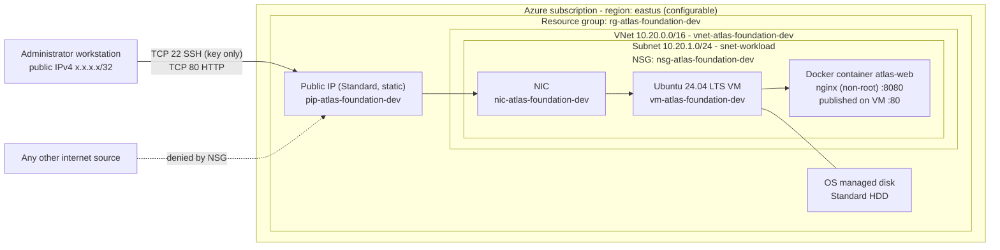

# Atlas Platform Foundation

Milestone 1 of the **Atlas** cloud engineering portfolio: a small, secure, fully
reproducible Azure landing spot for a containerised web service, built with
**Terraform**, **Azure networking**, **Ubuntu Linux**, **cloud-init** and **Docker**.

> **Status:** code and offline tests are complete. **No Azure deployment has been
> performed from this repository yet.** Deployment evidence must be captured from
> your own subscription (see [Evidence](#12-evidence-screenshots)).

---

## Contents

1. [Problem and scope](#1-problem-and-scope)
2. [Architecture](#2-architecture)
3. [Repository layout](#3-repository-layout)
4. [Prerequisites](#4-prerequisites)
5. [Authenticate with Azure CLI](#5-authenticate-with-azure-cli)
6. [Configure variables](#6-configure-variables)
7. [Validate, plan and apply](#7-validate-plan-and-apply)
8. [Connectivity checks](#8-connectivity-checks)
9. [Destroy and verify cleanup](#9-destroy-and-verify-cleanup)
10. [Resources and network rules explained](#10-resources-and-network-rules-explained)
11. [Troubleshooting](#11-troubleshooting)
12. [Evidence screenshots](#12-evidence-screenshots)
13. [Cost](#13-cost)
14. [Terraform state (local) and its limitations](#14-terraform-state-local-and-its-limitations)
15. [Offline validation and tests](#15-offline-validation-and-tests)
16. [Security notes and known limitations](#16-security-notes-and-known-limitations)

---

## 1. Problem and scope

**Problem.** Clicking resources together in the Azure portal is slow, hard to
repeat and easy to get wrong (for example, leaving SSH open to the whole
internet). An infrastructure engineer should be able to rebuild an environment
from code, secure by default, and tear it down again to control cost.

**This milestone delivers:**

- A dedicated resource group, one virtual network (VNet) and one subnet.
- A network security group (NSG) that allows **SSH (22) and HTTP (80) only from
  one administrator IPv4 address (`/32`)**. There is no internet-wide default.
- One Ubuntu Server 24.04 LTS VM with a network interface and a Standard static
  public IP.
- SSH **key** authentication only; password authentication is disabled.
- cloud-init installs Docker and starts a small hardened nginx container that
  shows **"Atlas Platform Foundation"** and exposes **`/health`** (HTTP 200).
- Consistent `Project`, `Environment`, `Owner` and `ManagedBy` tags.
- Offline tests (Terraform unit tests with a mocked provider, cloud-init schema
  checks and a local Docker test of the web service).

**Out of scope for now (deliberately):** Bastion, NAT Gateway, load balancer,
AKS/Kubernetes, dashboards, monitoring, CI/CD, TLS/HTTPS, remote state.

## 2. Architecture



Traffic flow: your workstation -> public IP -> NSG on the subnet (only your
`/32` on ports 22/80 is allowed) -> NIC -> VM. Docker publishes the container's
port 8080 on the VM's port 80. Outbound internet access uses Azure's default
outbound rules so the VM can download packages and the container image.

## 3. Repository layout

```text
atlas-platform-foundation/
├── versions.tf                  # Terraform + azurerm version constraints, provider block
├── variables.tf                 # Input variables with validation
├── locals.tf                    # Naming, common tags, rendered cloud-init
├── main.tf                      # Resource group + networking and compute modules
├── outputs.tf                   # Public IP, SSH command, URLs
├── terraform.tfvars.example     # Safe placeholder values (copy to terraform.tfvars)
├── .terraform.lock.hcl          # Provider lock file (committed on purpose)
├── modules/
│   ├── networking/              # VNet, subnet, NSG + rules, NSG-subnet association
│   └── compute/                 # Public IP, NIC, Linux VM
├── cloud-init/
│   └── cloud-init.yaml.tftpl    # First-boot config: Docker, sshd hardening, app
├── app/                         # The web service (same files are embedded in cloud-init)
│   ├── Dockerfile
│   ├── nginx.conf
│   ├── index.html
│   └── run-container.sh         # Builds and runs the container (VM and local test)
├── tests/                       # terraform test files (mocked provider, offline)
├── scripts/
│   ├── validate.sh              # Runs every offline check
│   ├── test-web-local.sh        # Local Docker test of / and /health
│   ├── render-cloud-init.sh     # Renders cloud-init exactly as Terraform would
│   ├── check-cloud-init-files.py
│   └── connectivity-check.sh    # Post-deployment checks against the real VM
└── docs/
    ├── validation-log.md        # Output of offline checks that were actually run
    └── evidence/                # Your redacted deployment screenshots
```

## 4. Prerequisites

| Tool | Version | Check |
| --- | --- | --- |
| Azure subscription | Permission to create resource groups, networks and VMs (e.g. Contributor) | `az account show` |
| Azure CLI | 2.60 or newer recommended | `az version` |
| Terraform | `>= 1.7.0, < 2.0.0` (1.7+ is required for the mocked tests) | `terraform version` |
| OpenSSH client | Built into Linux, macOS and Windows 10/11 | `ssh -V` |
| Git | Any recent version | `git --version` |
| Docker (optional) | Only for the local web test | `docker version` |

The scripts in `scripts/` are Bash. On Windows use **WSL** or **Git Bash**;
all Terraform and `az` commands below also work in PowerShell.

The azurerm provider is pinned with `~> 5.13` (any 5.x from 5.13 upwards) and
the exact version and checksums are recorded in `.terraform.lock.hcl` for
Linux, macOS and Windows.

## 5. Authenticate with Azure CLI

Terraform's azurerm provider reuses your Azure CLI login. No secrets or service
principal credentials are stored in this repository.

```bash
az login                                    # opens a browser; use --use-device-code on headless machines
az account list --output table              # find the subscription you want to use
az account set --subscription "<subscription-name-or-id>"
az account show --output table              # confirm the active subscription
```

Tell Terraform which subscription to use through an environment variable (this
keeps the subscription ID out of files):

```bash
# Bash / WSL / Git Bash / macOS
export ARM_SUBSCRIPTION_ID="$(az account show --query id --output tsv)"
```

```powershell
# PowerShell
$env:ARM_SUBSCRIPTION_ID = (az account show --query id --output tsv)
```

The variable only lasts for the current terminal session.

New subscriptions may need the resource providers registered (one-off):

```bash
az provider register --namespace Microsoft.Network
az provider register --namespace Microsoft.Compute
```

Check the VM size is offered in your region (an empty `Restrictions` column means
it is available to your subscription):

```bash
az vm list-skus --location eastus --size Standard_B2ats_v2 --output table
```

If it is restricted, pick another small size (for example `Standard_B1s` or
`Standard_B2s`) or another region and set `vm_size` / `location` accordingly.

## 6. Configure variables

### 6.1 Create an SSH key pair

```bash
ssh-keygen -t ed25519 -C "atlas-admin" -f ~/.ssh/atlas_admin
# PowerShell: ssh-keygen -t ed25519 -C "atlas-admin" -f $HOME\.ssh\atlas_admin
```

This creates `~/.ssh/atlas_admin` (**private** key - never share or commit it)
and `~/.ssh/atlas_admin.pub` (**public** key - this goes into Terraform).
RSA keys (`ssh-keygen -t rsa -b 4096`) are also accepted.

### 6.2 Find your public IPv4 address

```bash
curl -4 https://ifconfig.me ; echo
# PowerShell: (Invoke-RestMethod -Uri https://api.ipify.org)
```

Use the result with `/32`, for example `198.51.100.23/32`. If you use a VPN,
check the address while connected the same way you will be when testing.

### 6.3 Create `terraform.tfvars`

```bash
cp terraform.tfvars.example terraform.tfvars
# PowerShell: Copy-Item terraform.tfvars.example terraform.tfvars
```

Edit `terraform.tfvars`. The example file contains only placeholders:

```hcl
location = "eastus"

environment = "dev"
owner       = "your-name-or-email"

vm_size        = "Standard_B2ats_v2"
admin_username = "atlasadmin"

# Paste the single line from ~/.ssh/atlas_admin.pub (the PUBLIC key only).
admin_ssh_public_key = "ssh-ed25519 AAAA...replace-with-your-public-key... atlas-admin"

# Your current public IPv4 address with /32.
admin_source_ip_cidr = "203.0.113.10/32"
```

`terraform.tfvars` is listed in `.gitignore` and must never be committed.

### 6.4 Variable reference

| Variable | Required | Default | Purpose / validation |
| --- | --- | --- | --- |
| `owner` | yes | - | `Owner` tag. Must not be empty. |
| `admin_ssh_public_key` | yes | - | OpenSSH public key (`ssh-ed25519` or `ssh-rsa`). Private keys are rejected. |
| `admin_source_ip_cidr` | yes | - | One IPv4 address with `/32`. `0.0.0.0/0`, ranges like `/24` and bare IPs are rejected. |
| `location` | no | `eastus` | Azure region. |
| `vm_size` | no | `Standard_B2ats_v2` | VM size (2 vCPU burstable, 1 GiB RAM). |
| `admin_username` | no | `atlasadmin` | Linux admin user. Reserved names such as `admin`, `root`, `ubuntu` are rejected. |
| `environment` | no | `dev` | `dev`, `test` or `prod`. Used in names and the `Environment` tag. |
| `project_name` | no | `atlas-foundation` | Used in names and the `Project` tag. |
| `vnet_address_space` | no | `10.20.0.0/16` | VNet CIDR. |
| `subnet_address_prefix` | no | `10.20.1.0/24` | Subnet CIDR (inside the VNet). |

## 7. Validate, plan and apply

Run from the repository root.

```bash
terraform init                      # downloads the provider pinned in .terraform.lock.hcl
terraform fmt -check -recursive     # formatting check (no changes made)
terraform validate                  # syntax and type check
terraform test                      # offline unit tests (mocked provider, creates nothing)

terraform plan -out tfplan          # review: expect 11 resources to add, 0 to change, 0 to destroy
terraform apply tfplan              # creates the resources (this starts billing)
terraform output                    # shows public IP, SSH command and URLs
```

Read the plan before applying. Check in particular that both NSG allow rules
show your `/32` address and that `disable_password_authentication = true`.

The 11 resources are: resource group, VNet, subnet, NSG, 3 NSG rules,
NSG-subnet association, public IP, NIC and VM (the VM's OS disk is created as
part of the VM).

After `apply` finishes, **wait 3-5 minutes** for cloud-init to install Docker
and start the container before testing HTTP.

## 8. Connectivity checks

Run these from the machine whose IP you put in `admin_source_ip_cidr`.

```bash
IP=$(terraform output -raw public_ip_address)
# PowerShell: $IP = terraform output -raw public_ip_address

# Web service and health endpoint (expect HTTP/1.1 200 OK)
curl -i "http://$IP/health"
curl -s "http://$IP/" | grep "Atlas Platform Foundation"

# SSH with your private key
ssh -i ~/.ssh/atlas_admin atlasadmin@$IP

# On the VM:
cloud-init status --long          # expect: status: done
docker ps                         # expect atlas-web Up ... (healthy)
curl -s http://127.0.0.1/health   # expect {"status":"ok",...}
sudo sshd -T | grep -E '^(passwordauthentication|permitrootlogin)'   # expect "no"
exit
```

Prove password logins are refused (expect `Permission denied (publickey)`):

```bash
ssh -o PubkeyAuthentication=no -o PreferredAuthentications=password atlasadmin@$IP
```

Or run all of the above in one go (Bash):

```bash
./scripts/connectivity-check.sh             # uses ~/.ssh/atlas_admin by default
SSH_KEY=~/.ssh/other_key ./scripts/connectivity-check.sh
```

Negative test (optional, recommended for evidence): from a different network
(for example a phone on mobile data) `http://<public-ip>/` should **time out**.

## 9. Destroy and verify cleanup

```bash
terraform plan -destroy -out destroy.tfplan   # review: expect 11 to destroy
terraform apply destroy.tfplan
# or simply: terraform destroy
```

Verify nothing is left (and nothing is still billing):

```bash
terraform state list                                        # expect no output
az group exists --name rg-atlas-foundation-dev              # expect: false
az resource list --tag Project=atlas-foundation --output table   # expect no rows
az disk list --query "[?contains(name,'atlas')]" --output table  # expect no rows
az network public-ip list --query "[?contains(name,'atlas')]" --output table  # expect no rows
```

Notes:

- Azure may automatically create a `NetworkWatcherRG` resource group with a
  Network Watcher when you create a VNet. It is not managed by this project and
  has no meaningful cost on its own; delete it only if you know nothing else in
  the subscription uses it.
- If you lost your local state file, delete everything with
  `az group delete --name rg-atlas-foundation-dev --yes` and run the checks above.
- Finally, review **Cost Management -> Cost analysis** in the portal a day later
  (cost data is delayed by up to 24-48 hours).

## 10. Resources and network rules explained

### 10.1 Resources

| Resource (Terraform type) | Name | Why it exists |
| --- | --- | --- |
| Resource group (`azurerm_resource_group`) | `rg-atlas-foundation-dev` | A dedicated container for every resource, so the project can be inspected, costed and deleted as one unit. |
| Virtual network (`azurerm_virtual_network`) | `vnet-atlas-foundation-dev` | Private network `10.20.0.0/16` for the workload. Free. |
| Subnet (`azurerm_subnet`) | `snet-workload` | `10.20.1.0/24` segment the VM's NIC is placed in. Room for future subnets. |
| Network security group (`azurerm_network_security_group` + `azurerm_network_security_rule` x3) | `nsg-atlas-foundation-dev` | Stateful firewall. Rules are separate resources so each is easy to read and test. |
| NSG association (`azurerm_subnet_network_security_group_association`) | - | Applies the NSG to the whole subnet, so any future VM in the subnet is protected too. Created before the VM. |
| Public IP (`azurerm_public_ip`) | `pip-atlas-foundation-dev` | Standard SKU, static. Standard IPs are "secure by default": inbound is blocked unless an NSG allows it. Static keeps the same address across VM restarts. |
| Network interface (`azurerm_network_interface`) | `nic-atlas-foundation-dev` | Connects the VM to the subnet (dynamic private IP) and attaches the public IP. |
| Linux VM (`azurerm_linux_virtual_machine`) | `vm-atlas-foundation-dev` | Ubuntu Server 24.04 LTS (`Canonical/ubuntu-24_04-lts/server`). SSH key only, password auth disabled, cloud-init passed as `custom_data`, managed boot diagnostics enabled for the serial log/console. |
| OS disk (part of the VM) | `osdisk-atlas-foundation-dev` | `Standard_LRS` (HDD) managed disk - the cheapest option; fine for a lab. |

Inside the VM, cloud-init:

1. Installs `docker.io` and `curl` from the Ubuntu archive.
2. Writes `/etc/ssh/sshd_config.d/10-atlas-hardening.conf` (no passwords, no
   keyboard-interactive, no root login) as defence in depth.
3. Writes the app files to `/opt/atlas/app` and runs `run-container.sh`, which
   builds the image and runs the container with: non-root user, read-only root
   filesystem, all Linux capabilities dropped, `no-new-privileges`, 128 MiB
   memory limit, a Docker `HEALTHCHECK`, and `--restart unless-stopped` so it
   comes back after a reboot.
4. Adds the admin user to the `docker` group (convenient for troubleshooting;
   note that `docker` group membership is effectively root access).

### 10.2 Network rules

Custom inbound rules (lower priority number = evaluated first):

| Priority | Name | Source | Destination | Port / protocol | Action | Why |
| --- | --- | --- | --- | --- | --- | --- |
| 100 | `Allow-SSH-From-Admin` | your `/32` | subnet `10.20.1.0/24` | 22 / TCP | Allow | Administration over SSH from your IP only. |
| 110 | `Allow-HTTP-From-Admin` | your `/32` | subnet `10.20.1.0/24` | 80 / TCP | Allow | View the web service and `/health` from your IP only. |
| 4000 | `Deny-Internet-Inbound` | `Internet` | any | any | Deny | Makes the "everyone else is blocked" intent explicit and visible. |

Azure also adds default rules that cannot be deleted:

| Priority | Direction | Name | Effect |
| --- | --- | --- | --- |
| 65000 | Inbound | `AllowVnetInBound` | Traffic from inside the VNet is allowed. |
| 65001 | Inbound | `AllowAzureLoadBalancerInBound` | Azure health probes are allowed. |
| 65500 | Inbound | `DenyAllInBound` | Everything else is denied. |
| 65000 | Outbound | `AllowVnetOutBound` | Traffic to the VNet is allowed. |
| 65001 | Outbound | `AllowInternetOutBound` | The VM can reach the internet (apt, Docker Hub). |
| 65500 | Outbound | `DenyAllOutBound` | Everything else is denied. |

NSGs are **stateful**: reply traffic for an allowed connection is automatically
allowed back, so no matching outbound rules are needed.

If your public IP changes, update `admin_source_ip_cidr` in `terraform.tfvars`
and run `terraform apply` again. Only the two NSG rules change; the VM is not
recreated.

## 11. Troubleshooting

Start by confirming three facts: the VM is running, your **current** public IP
matches `admin_source_ip_cidr`, and cloud-init has finished.

```bash
az vm get-instance-view -g rg-atlas-foundation-dev -n vm-atlas-foundation-dev \
  --query "instanceView.statuses[?starts_with(code,'PowerState')].displayStatus" -o tsv
curl -4 https://ifconfig.me ; echo
terraform output
```

### SSH

| Symptom | Likely cause | Fix |
| --- | --- | --- |
| `Connection timed out` | Your IP is not the one in the NSG (changed, VPN, corporate proxy), or VM stopped. | Re-check your IP, update `admin_source_ip_cidr`, `terraform apply`. Start the VM: `az vm start -g rg-atlas-foundation-dev -n vm-atlas-foundation-dev`. |
| `Permission denied (publickey)` | Wrong private key or wrong username. | Use `-i ~/.ssh/atlas_admin` and the `admin_username` value. Debug with `ssh -vvv ...`. |
| `UNPROTECTED PRIVATE KEY FILE` | Key file permissions too open. | Linux/macOS: `chmod 600 ~/.ssh/atlas_admin`. Windows: `icacls $HOME\.ssh\atlas_admin /inheritance:r /grant:r "$($env:USERNAME):(R)"`. |
| `REMOTE HOST IDENTIFICATION HAS CHANGED` | VM was recreated with the same IP. | `ssh-keygen -R <public-ip>` then reconnect. |
| Check the NSG Azure actually applies | - | `az network nic list-effective-nsg -g rg-atlas-foundation-dev -n nic-atlas-foundation-dev -o table` |
| Check if a packet would be allowed | - | `az network watcher test-ip-flow --direction Inbound --protocol TCP --local <private-ip>:22 --remote <your-ip>:50000 --vm vm-atlas-foundation-dev -g rg-atlas-foundation-dev` |

No SSH at all? You can still run commands through the Azure VM agent:

```bash
az vm run-command invoke -g rg-atlas-foundation-dev -n vm-atlas-foundation-dev \
  --command-id RunShellScript --scripts "cloud-init status --long; docker ps -a"
```

### cloud-init

```bash
cloud-init status --long                      # running / done / error
sudo tail -n 100 /var/log/cloud-init-output.log   # output of package installs and runcmd
sudo grep -iE "error|warn|fail" /var/log/cloud-init.log
sudo cloud-init schema --system               # validates the user-data the VM received
```

From outside the VM: `az vm boot-diagnostics get-boot-log -g rg-atlas-foundation-dev -n vm-atlas-foundation-dev`
or use **Serial console** in the portal.

- `status: running` - still working; wait and check again (`cloud-init status --wait`).
- Package install failures - usually transient mirror/network issues. Re-run
  manually: `sudo apt-get update && sudo apt-get install -y docker.io`, then
  `sudo /opt/atlas/app/run-container.sh`.
- Changes to `cloud-init/` or `app/` force the VM to be **replaced** on the next
  apply, because cloud-init only runs on first boot. `terraform plan` will show
  `forces replacement` on `custom_data`.

### Docker

```bash
systemctl status docker --no-pager
docker ps -a                                   # is atlas-web Up and (healthy)?
docker logs atlas-web
docker inspect --format '{{json .State.Health}}' atlas-web
sudo /opt/atlas/app/run-container.sh           # rebuild and restart the container
```

- `permission denied ... docker.sock` - your session started before the user
  joined the `docker` group. Log out and back in, or use `sudo docker ...`.
- `toomanyrequests` / `429` when pulling the base image - Docker Hub anonymous
  rate limit. Wait and re-run `run-container.sh`, or use another registry mirror:
  `sudo BASE_IMAGE=public.ecr.aws/nginx/nginx-unprivileged:1.30-alpine /opt/atlas/app/run-container.sh`.

### HTTP

Work from the inside out:

1. On the VM: `curl -i http://127.0.0.1/health` - fails? It is a Docker/container problem (see above).
2. On the VM: `sudo ss -tlnp | grep ':80 '` - Docker (`docker-proxy`) should be listening on port 80.
3. From your machine: `curl -4 -iv --max-time 10 http://<public-ip>/health`
   - **Timeout** -> NSG/source IP problem (see SSH table; same checks for port 80).
   - **Connection refused** -> traffic reaches the VM but nothing listens on 80 (container down).
   - **200** -> working. If the browser still fails, make sure it uses `http://`, not `https://`
     (HTTPS is not configured in this milestone) and that no corporate proxy is in the way.

## 12. Evidence screenshots

Save redacted screenshots in `docs/evidence/` with these names:

| File | What it should show |
| --- | --- |
| `01-local-validate.png` | `./scripts/validate.sh` finishing with "All available offline checks passed." |
| `02-terraform-plan.png` | Plan summary `Plan: 11 to add, 0 to change, 0 to destroy.` |
| `03-terraform-apply-outputs.png` | `Apply complete!` and `terraform output` |
| `04-portal-resource-group.png` | Resource group with its resources and tags |
| `05-nsg-inbound-rules.png` | NSG inbound rules showing the `/32` source |
| `06-browser-landing-page.png` | Browser at `http://<ip>/` showing "Atlas Platform Foundation" |
| `07-health-endpoint-200.png` | `curl -i http://<ip>/health` showing `HTTP/1.1 200 OK` |
| `08-ssh-cloud-init-docker.png` | SSH session with `cloud-init status --long` and `docker ps` (healthy) |
| `09-password-auth-refused.png` | `Permission denied (publickey)` for a password-only attempt |
| `10-blocked-from-other-network.png` | Request timing out from a different network |
| `11-terraform-destroy.png` | `Destroy complete! Resources: 11 destroyed.` |
| `12-cleanup-verified.png` | `az group exists` -> `false` and empty `az resource list` |

**Hide sensitive information before committing screenshots:**

- Subscription ID, tenant ID, directory name and account email (portal header,
  `az account show`, resource IDs which contain `/subscriptions/<id>/`).
- Your home/office public IP (in NSG rules, tfvars, `curl ifconfig.me`).
  The VM's public IP is released on destroy, but redacting it is still good practice.
- Never screenshot `terraform.tfvars`, `terraform.tfstate`, private keys or
  `~/.ssh` contents.
- Use an opaque box, not blur or low-opacity highlighting (blur can sometimes be
  reversed). Crop out browser bookmarks, other tabs and notifications.
- Check terminal prompts for usernames/hostnames you do not want public.

## 13. Cost

### Cost drivers

| Item | Charged? | Notes |
| --- | --- | --- |
| VM compute (`Standard_B2ats_v2`) | Yes, per second while **running** | Largest cost. Burstable B-series. |
| OS managed disk (Standard HDD, 30 GiB image -> billed as 32 GiB S4) | Yes, **always** until deleted | Plus a small per-transaction charge. |
| Standard static public IPv4 | Yes, **always** until deleted | Billed hourly whether or not the VM runs. |
| Boot diagnostics (managed storage) | Minimal | Small storage for screenshots/serial log. |
| Outbound data transfer | Small | Inbound is free; the first 100 GB/month outbound is free at the time of writing. |
| Resource group, VNet, subnet, NSG | No | Free. |

### Indicative estimate

Assumptions: East US, Linux, pay-as-you-go list prices in USD, 730 hours/month,
no free-account credits, no reservations, negligible data transfer. These are
approximate figures from public list prices and **will change** - confirm with
the [Azure Pricing Calculator](https://azure.microsoft.com/pricing/calculator/)
before deploying.

| Item | Approx. hourly | Approx. per month (730 h) |
| --- | --- | --- |
| `Standard_B2ats_v2` VM | ~$0.0094 | ~$6.90 |
| Standard static public IP | ~$0.005 | ~$3.65 |
| Standard HDD S4 OS disk | - | ~$1.55 |
| **Total (running 24/7)** | **~$0.017** | **~$12** |
| **Lab use: one 4-hour session, then destroy** | | **~$0.07** |

If you have an Azure free account, `Standard_B2ats_v2` Linux hours may be
covered by the 12-month free services allowance - check your account's current
free-service terms; the public IP and other items may still be charged.

### Stopping the VM does not remove all charges

- **Stop (deallocate)** from the portal or `az vm deallocate` stops compute
  charges, but the **OS disk and the static public IP keep billing**
  (~$5/month with the figures above).
- **Shutting down from inside Linux** (`sudo shutdown now`) leaves the VM
  *Stopped* but **still allocated, so compute is still billed**. The portal
  shows "Stopped" instead of "Stopped (deallocated)".
- The only way to reach **zero** cost is `terraform destroy` and the cleanup
  checks in [section 9](#9-destroy-and-verify-cleanup).

Optional: create a budget alert in **Cost Management -> Budgets** (for example
$10/month) as a safety net.

## 14. Terraform state (local) and its limitations

This milestone stores state in `terraform.tfstate` in the repository folder
(ignored by Git). This keeps the first milestone simple, but:

- **Single machine only.** Another computer (or teammate) cannot manage the
  same resources without copying the file.
- **No shared locking.** Terraform locks the local file only on this machine;
  two people with copies would overwrite each other.
- **Contains sensitive data in plain text** (your IP, public key, resource IDs,
  the full cloud-init). Never commit, share or upload it.
- **Easy to lose.** If the file is deleted, Terraform "forgets" the resources but
  they keep running and billing. Recover with `az group delete` (section 9).
- **No history/versioning or backup.**

Planned for a later milestone: an `azurerm` remote backend (Azure Storage
account with blob versioning and state locking).

## 15. Offline validation and tests

Everything below runs **without an Azure account** and creates nothing:

```bash
./scripts/validate.sh
```

It runs, in order:

1. `terraform fmt -check -recursive`
2. `terraform init -backend=false`
3. `terraform validate`
4. `terraform test` - 8 test runs with a **mocked azurerm provider**:
   - networking module: SSH/HTTP rules allow only the `/32`, correct ports,
     explicit Internet deny, subnet prefix, tags;
   - compute module: password auth disabled and no password set, SSH key user,
     Ubuntu 24.04 image, base64 `custom_data`, Standard static IP, tags;
   - root: names/tags, rendered cloud-init content, and **rejection** of
     `0.0.0.0/0`, `/24` ranges, IPs without `/32`, private keys and reserved
     usernames.
5. Renders cloud-init exactly as Terraform would and checks the embedded app
   files match `./app` byte-for-byte.
6. `cloud-init schema` validation of the rendered file (if cloud-init is installed).
7. `shellcheck` of all scripts (if installed).
8. Local Docker test (`scripts/test-web-local.sh`): builds the image with the same
   script the VM uses and checks `/` (title text, 200), `/health` (200 + JSON),
   unknown path (404), hidden nginx version, non-root user, read-only root
   filesystem and Docker `HEALTHCHECK` = healthy.

If Docker Hub rate-limits your machine, use a mirror for the local test:
`BASE_IMAGE=mirror.gcr.io/nginxinc/nginx-unprivileged:1.30-alpine ./scripts/validate.sh`.

What these tests **cannot** prove: that Azure accepts the deployment in your
subscription/region (quota, SKU availability, policy), that the VM boots and
cloud-init succeeds on Azure, or that the NSG behaves as expected on the real
network. Those are verified by sections 7-9 and recorded with the evidence
screenshots. See [`docs/validation-log.md`](docs/validation-log.md) for the
offline checks that have actually been run.

## 16. Security notes and known limitations

- HTTP only (no TLS) - acceptable here because only your `/32` can connect.
  HTTPS is a future milestone.
- The VM has a public IP; access is restricted by the NSG rather than by a
  private-only design with Bastion/VPN (avoided for cost).
- `admin_source_ip_cidr` supports one IPv4 address. If your ISP changes your IP,
  re-apply with the new one.
- The container image is built on the VM from a pinned minor version
  (`nginx-unprivileged:1.30-alpine`); it is not pinned by digest and is not
  automatically rebuilt for security patches.
- Ubuntu's unattended-upgrades applies security updates by default; reboots are
  not automated.
- `package_upgrade` is disabled in cloud-init to keep first boot fast and
  predictable.
