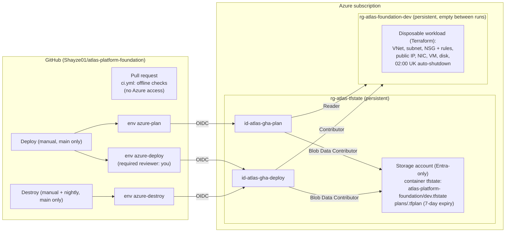

# Milestone 2 - Deployment engine (GitHub Actions + Azure OIDC + remote state)

Status: **code and offline tests only.** The bootstrap, GitHub setup and workflows
below have **not** been run against Azure or GitHub yet; nothing in this document is
deployment evidence. Milestone 1 (local state, manual `terraform apply`) still works
unchanged, and its 2026-11-13 evidence in `docs/evidence/` is untouched.

Long-term direction: a self-service platform for secure, temporary cloud environments.
This milestone builds the engine that creates, validates and removes one environment
(the Milestone 1 VM design) safely and repeatably.

## 1. Architecture



| Layer | Resources | Created by | Lifetime |
| --- | --- | --- | --- |
| Bootstrap (persistent) | `rg-atlas-tfstate`, storage account `statlas<hash>` + container `tfstate`, delete lock, lifecycle policy, two user-assigned managed identities + 3 federated credentials, **empty** `rg-atlas-foundation-dev`, 4 role assignments | `bootstrap/bootstrap.sh` (you, once) | Until `bootstrap/teardown.sh` |
| GitHub config | OIDC subject template, 3 environments, variables, environment secrets | `scripts/github/setup-github.sh` (you, once) | Until removed |
| Workload (disposable) | VNet, subnet, NSG, 3 NSG rules, NSG association, public IP, NIC, VM (+ OS disk), auto-shutdown schedule | Deploy workflow (Terraform, remote state) | Minutes to hours; destroyed by the workflows |

**Why the workload resource group survives routine teardown.** In CI the root module
runs with `create_resource_group = false`: Terraform reads `rg-atlas-foundation-dev`
through a data source instead of managing it, so `terraform destroy` removes only the
resources inside it. The group, and the deployment identity's role assignment scoped
to it, are bootstrap resources outside Terraform state, so the next Deploy run still
has a target and permissions. (Milestone 1's local workflow keeps the default `true`:
Terraform creates and deletes the group; a `moved` block maps the old state address.)

## 2. Trust boundaries and permissions

| Principal | Can do | Cannot do |
| --- | --- | --- |
| Pull-request code (`ci.yml`) | Read the repository, run offline checks | Obtain any Azure token (no `id-token` permission, no secrets, no environment) |
| `id-atlas-gha-plan` (env `azure-plan`) | **Reader** on `rg-atlas-foundation-dev`; **Storage Blob Data Contributor** on the `tfstate` container only (state lock lease, saved plan upload) | Change any Azure resource; touch other groups; assign roles |
| `id-atlas-gha-deploy` (envs `azure-deploy`, `azure-destroy`) | **Contributor** on `rg-atlas-foundation-dev`; **Storage Blob Data Contributor** on the `tfstate` container | Assign roles (Contributor excludes `Microsoft.Authorization/*/write`); touch the state account's settings, other groups, `NetworkWatcherRG` or other Atlas labs |
| You (owner) | Run bootstrap/teardown/GitHub setup; approve `azure-deploy` | - |

- **No stored credentials.** Identities are user-assigned managed identities: they have
  no client secrets or certificates to leak. The storage account has
  `allowSharedKeyAccess = false`, so account keys and SAS tokens do not work; the
  backend uses Entra ID (`use_azuread_auth`, `use_oidc`). `backend-init.sh` refuses to
  run if a client secret, certificate or access key is present in the environment.
- **Federated credentials are exact.** The repository's OIDC subject template includes
  `repo`, `context` and `ref`, so each identity trusts exactly
  `repo:Shayze01/atlas-platform-foundation:environment:<env>:ref:refs/heads/main`.
  A token from another branch, a pull request, a fork or another environment does not
  match and Azure refuses it (fails closed).
- **Three layers keep Azure jobs on trusted `main`:** workflow triggers are only
  `workflow_dispatch`/`schedule`; each Azure job has `if: github.ref == 'refs/heads/main'`;
  each environment allows deployments from `main` only.
- **Approval.** Only the apply job uses `azure-deploy`, which requires your review.
  "Prevent self-review" is **off** so you, as the only maintainer, can approve your own
  run (a rule you could not satisfy would block every deployment). `azure-destroy`
  deliberately has **no** reviewer so cleanup never waits for a human.
- **Workflow token** defaults to read-only; every workflow declares minimal permissions.
  All actions are pinned to full commit SHAs. `tests/workflows/test_workflow_policy.py`
  enforces these rules and proves it rejects bad fixtures.
- **Residual risk (stated honestly):** anyone who can push to `main` controls workflow
  code that runs with the deploy identity. On this solo repository that is only you;
  adding collaborators would need branch protection with required reviews.

## 3. What never appears in public logs or artifacts

Raw plans, state, tfvars, credentials and personal IPs are not published:

- No workflow uploads artifacts (enforced by the policy test).
- `terraform plan` output goes to a runner-local file; the run summary shows only
  resource addresses, actions, counts and the plan SHA-256 (`scripts/ci/plan-summary.sh`).
- Admin IP, SSH public key and owner tag are **environment secrets**, so GitHub masks
  them. The runner's own IP is masked with `::add-mask::` before use.
- Every Terraform/validation step pipes through `scripts/ci/sanitize.sh`, which masks
  IPv4 addresses, GUIDs (subscription/tenant/object IDs), SSH keys, key fingerprints
  and SAS signatures.
- **Reviewed plan retention:** the binary plan is uploaded to `plans/<run-id>-<attempt>.tfplan`
  in the private, Entra-only state container. The apply job downloads it, verifies the
  SHA-256 recorded by the plan job, applies exactly that file (Terraform also rejects
  it if state changed since planning), then deletes it. If the plan has no changes
  (for example a workload left running with `keep-running`), the apply job still runs
  after approval: it skips the apply but validates, and with `destroy` removes, the
  existing workload. A lifecycle rule deletes any
  leftover plan after 7 days.

## 4. Workflows

| Workflow | Trigger | Jobs | Azure access |
| --- | --- | --- | --- |
| `ci.yml` | pull request to `main`, push to `main` | `validate.sh` with `REQUIRE_ALL=1` (fmt, init, validate, 17 mocked Terraform tests, cloud-init render/schema, script tests, workflow policy, actionlint, ShellCheck, Docker web test). A skipped check fails the job. | None |
| `deploy.yml` | manual, `main` only; input `after_validation` = `destroy` (default) or `keep-running` | **plan** (`azure-plan`) -> **apply** (`azure-deploy`, your approval): apply reviewed plan, temporary runner /32, wait for `/health`, `azure-validate.sh public`, `in-vm`, remove temporary rule (always), `azure-validate.sh blocked`, destroy + verify (if `destroy`) -> **failure-cleanup** (`azure-destroy`) if apply/validation failed or was cancelled | plan: Reader; apply/cleanup: Contributor |
| `destroy.yml` | manual, and nightly 03:30 UTC | remove temporary rule if present, `terraform destroy`, `verify-cleanup.sh` with `KEEP_RESOURCE_GROUP=1` | Contributor |

`deploy.yml` and `destroy.yml` share the concurrency group `atlas-azure-dev` with
`cancel-in-progress: false`, so a deployment and a destruction never run at the same
time (GitHub keeps at most one queued run per group; a newer queued run replaces an
older *queued* one). Terraform's blob-lease state lock is a second guard.

### Validation and temporary access

The runner's IP changes every run, so the apply job:
1. gets its public IPv4 from two services and continues only if they agree and the
   address is public unicast (`scripts/ci/runner-ip.sh`);
2. adds **one** NSG rule `Allow-CI-Runner-Temporary` (priority 130, that /32 only,
   TCP 22 and 80; `scripts/ci/temp-access.sh` refuses anything else);
3. reuses the Milestone 1 checks: `azure-validate.sh public` (HTTP status/body, no-key
   SSH refused) and `in-vm` (Run Command: cloud-init, container health, local
   `/health`, effective sshd settings, admin key fingerprint, outbound IP);
4. removes the rule in an `always()` step and confirms Azure reports it **NotFound**
   (an error is inconclusive, never "removed");
5. runs `azure-validate.sh blocked`: only the admin rules and the Internet deny remain,
   and the runner's HTTP/SSH probes now time out.
Failure paths: the remove step runs even after a failed check; `failure-cleanup` and
`destroy.yml` also remove the rule (and destroying the NSG removes it anyway).

The workflows never test **your** key-based SSH login: that needs your private key,
which stays on your laptop (`scripts/connectivity-check.sh`).

## 5. Owner setup (once; not run yet)

Prerequisites: Azure CLI signed in as you (Owner, or Contributor + User Access
Administrator, on the subscription), GitHub CLI signed in as `Shayze01`, `jq`.

1. **Review** `bootstrap/bootstrap.sh`, then dry-run it (read-only):
   ```bash
   bootstrap/bootstrap.sh --tenant <tenant-id> --subscription <subscription-id> --owner-tag "<your name>"
   ```
   It checks the signed-in tenant/subscription, refuses to continue if either target
   group contains resources it did not create, and lists every change.
2. Apply: add `--apply`. It prints the GitHub values (tenant, subscription, two client
   IDs, storage account, container) - identifiers, not credentials.
3. **Review** `scripts/github/setup-github.sh`, export those values plus
   `ADMIN_SOURCE_IP_CIDR=<your-ip>/32`, `ADMIN_SSH_PUBLIC_KEY_FILE=~/.ssh/atlas_admin.pub`,
   `OWNER_TAG=...`, dry-run it, then run it with `--apply`.
4. Check the environments in **Settings -> Environments**: `azure-deploy` lists you as
   required reviewer with "Prevent self-review" unticked; all three allow `main` only.

Then: **Actions -> Deploy -> Run workflow** (branch `main`). Read the plan summary,
approve the `azure-deploy` review, and watch validation and teardown.

## 6. Routine destroy vs complete teardown

| | Routine destroy | Complete teardown |
| --- | --- | --- |
| How | `destroy.yml` (manual/nightly), Deploy's `destroy` option, failure-cleanup | `bootstrap/teardown.sh --apply` (you) |
| Removes | VM, disk, NIC, public IP, NSG + rules, subnet, VNet, schedule | Empty workload group (and its role assignments), identities (and federated credentials), state-container role assignments, delete lock, then `rg-atlas-tfstate` **last** |
| Keeps | Workload group, role assignments, identities, state backend | Nothing (remove the GitHub environments/variables manually if wanted) |
| Safety | `verify-cleanup.sh` (`KEEP_RESOURCE_GROUP=1`) must find the group present and empty | Refuses (exit 1) while the workload group has any resource or the state tracks any managed resource; any read error stops it (exit 2) |

## 7. Recovery

| Problem | Recovery |
| --- | --- |
| State lock stuck (job killed mid-run) | `az storage blob lease break --auth-mode login --account-name <sa> -c tfstate -b atlas-platform-foundation/dev.tfstate`, or `terraform force-unlock <id>` from an authorised shell. Make sure no workflow is running first. |
| State overwritten or corrupted | Blob versioning: `az storage blob list --auth-mode login --account-name <sa> -c tfstate --prefix atlas-platform-foundation/ --include v`, then copy the wanted version over the current blob. Old versions are kept 30 days. |
| State blob or container deleted | Soft delete keeps blobs and containers for 14 days: `az storage blob undelete` / `az storage container restore`. |
| Storage account deletion attempted | Blocked by the `CanNotDelete` lock (only teardown removes it). |
| Workload left running (failed cleanup, `keep-running`) | Run **Destroy**. Fallback from Cloud Shell: delete the resources in `rg-atlas-foundation-dev` (keep the group), e.g. `az resource list -g rg-atlas-foundation-dev -o table` then `az vm delete ...`; or delete the group and re-run the bootstrap. |
| OIDC login fails (`AADSTS70021`, subject mismatch) | Check the run is on `main`, the environment name, and that the OIDC subject template was applied (step 5.3). |
| Plan rejected as stale | Something changed state after planning; run Deploy again for a fresh plan. |

## 8. Costs (estimates, not yet measured)

Prices: Azure retail list prices fetched 2026-11-13 (GBP, East US, pay-as-you-go,
excluding VAT; +20% UK VAT shown where relevant). Re-check before deploying.

| Item | Driver | Estimate |
| --- | --- | --- |
| VM `Standard_B2ats_v2` | running hours | £0.0071/h |
| Standard static public IP | hours it exists (also while VM deallocated) | £0.0038/h |
| OS disk S4 Standard HDD | exists (also while deallocated) | £1.1548/month |
| State storage (LRS Hot, KB of state + versions + plans) | stored GB + transactions | well under £0.10/month (not separately priced yet) |
| Managed identities, role assignments, locks, OIDC | - | no charge |
| GitHub Actions (standard runners, public repo) | minutes | no charge |
| One Deploy run (plan + apply + validate + destroy, ~30-60 min of workload) | | about £0.01 inc. VAT |
| Workload forgotten for a month | | about £10.93 inc. VAT running; about £4.71 if only deallocated by auto-shutdown |

**Safeguards, not spending caps.** The 02:00 UK auto-shutdown deallocates the VM but
the IP and disk keep billing; the nightly Destroy run can be delayed or skipped by
GitHub (and is disabled after 60 days without repository activity); failure cleanup
can itself fail (e.g. Azure outage, expired permissions). The £5 budget alert only
notifies. Check Cost Management after every live session.

## 9. Not yet tested

- No part of the bootstrap, GitHub setup or workflows has run against real Azure or
  GitHub; the OIDC subject format, role sufficiency (e.g. Reader for planning, Run
  Command with Contributor), storage lifecycle filters and environment approval flow
  are verified only by reading documentation and by stubbed tests.
- `ci.yml` will run for the first time on this pull request.
