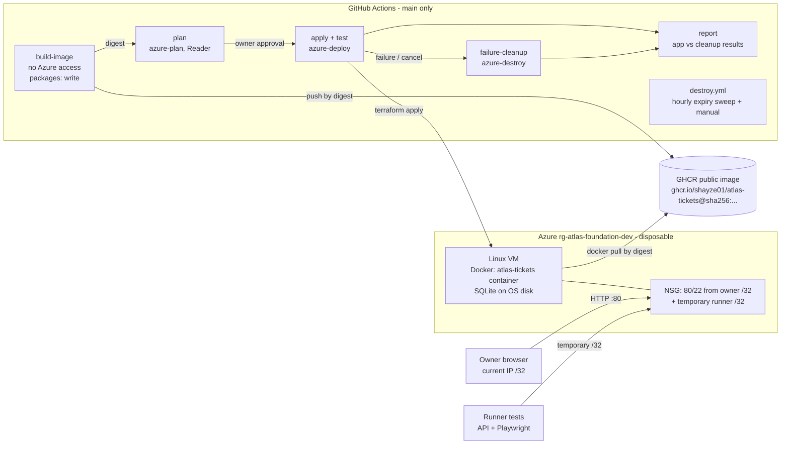

# Milestone 3 design review: support-ticket application on Atlas

Status: **revision 3** (revision 2 reviewed by the owner on 2026-11-16; owner requirements of 2026-11-16 21:09 applied and implemented offline in Stages 2-4; changes listed in section 17).
Baseline: `main` @ `ac8a1a2` (merged Stage 1: Atlas Service Desk app in `tickets-app/`, PR #6, on top of the Milestone 2 deployment engine whose first live run passed on 2026-11-14).

## 1. Goal and scope

Deploy a small, real support-ticket web application with the existing Atlas engine and test it there automatically and by hand. The pieces are:
- the existing Terraform infrastructure;
- remote state;
- the OIDC identities;
- the `azure-deploy` approval gate;
- the `/32`-restricted NSG.

This milestone establishes the **application deployment and test flow** that a later self-service dashboard will drive.

**In scope**
- Ticket app.
- Image build with an exact version.
- API and browser tests.
- A labelled broken variant.
- A manual inspection window.
- Expiry and cleanup.
- Docs and sanitised evidence.

**Out of scope**
- Dashboard.
- Multi-user authentication.
- TLS or custom domain.
- Multiple concurrent environments.
- Azure Container Registry.
- Any new Azure roles.

## 2. Architecture



**Application:** "Atlas Service Desk (demo)".
- **Runtime (owner's choice):** Python 3.12, **Flask** served by **Gunicorn**, with SQLite from the standard library and a vanilla HTML/CSS/JS front end.
- **Dependencies:** pinned in `tickets-app/requirements.txt` with exact versions **and hashes**, installed with `pip install --require-hashes --no-deps`. The base image `python:3.12-slim` is pinned by digest. No build tools are left in the final image.
- **Gunicorn:** 2 workers, bound to `0.0.0.0:8080` inside the container. The VM maps host port 80 to it.
- **UI:**
  - ticket list with filters (status, priority);
  - create form (title, description, priority Low/Medium/High/Critical, requester);
  - detail view with a status change (Open, In progress, Resolved, Closed) and an activity history;
  - a header banner showing the environment's **expiry time** and the image version.
- **API:**
  - `GET /api/tickets`
  - `POST /api/tickets`
  - `GET /api/tickets/{id}`
  - `PATCH /api/tickets/{id}` (status, priority)
  - `GET /health`
  - `GET /version`: git SHA, image variant (`healthy` or `broken-ignore-status`), build time.
- **Fictional data only:**
  - seed tickets for "Atlas Example Ltd";
  - people such as "Sam Example", with addresses at `example.com`;
  - no real names and no connection to BOFA systems or data;
  - a footer stating "Fictional demo data".
- **Container hardening:** the same as today's `atlas-web`. Non-root, read-only root filesystem, `--cap-drop ALL`, `no-new-privileges`, memory and PID limits. The only writable paths are one data volume and `/tmp`.

## 3. Image build and the exact deployed version

| Step | Detail |
|---|---|
| Build | New `build-image` job in `deploy.yml` (main only, no Azure credentials, `permissions: contents: read, packages: write`). `scripts/ci/build-push.sh` builds `tickets-app/` with the Docker CLI (`--target healthy` or, only for the failure scenario, `--target broken-ignore-status`), checks the `atlas.variant` label and pushes. The base image is pinned by **digest**. |
| Push | `ghcr.io/shayze01/atlas-tickets:<first 12 of git sha>-<variant>`. The job output is the **digest** (`sha256:...`). |
| Deploy | Terraform variable `app_image = "ghcr.io/shayze01/atlas-tickets@sha256:<64 hex>"`. Cloud-init only runs `docker pull <image@digest>` plus `docker run`. No build on the VM, so `custom_data` stays far below Azure's 64 KB limit. |
| Review | The plan summary prints the image reference and variant. New fail-closed policy checks: the image must be a GHCR digest reference in this repo's namespace, and its variant must match the `scenario` input. |
| Proof | An in-VM check compares `docker inspect` RepoDigests with the planned digest. A public check compares `/version` with the git SHA and variant. Both appear in the evidence. |
| Labels | OCI labels `org.opencontainers.image.revision=<git sha>`, `org.opencontainers.image.source`, `atlas.variant`. |

**Why GHCR:**
- **Free and keyless:** a public package for this public repository costs nothing and needs no pull secret on the VM. It contains only demo code.
- **Rejected, ACR:** costs about £4/month and needs an `AcrPull` role assignment, which the deploy identity can't grant.
- **Rejected, building on the VM:** not reproducible, and `custom_data` has a size limit.

**One-time owner action at implementation time:** make the package public after the first push. To make that possible, a small `build-image.yml` (`workflow_dispatch`, no Azure) is added so the package can exist before the first Deploy.

## 4. Ticket data: where it lives and when it is deleted

- **Location:** a SQLite file at `/var/lib/atlas-tickets/tickets.db`. It is a Docker volume on the VM's **OS disk**.
- **Not stored elsewhere:** not in Terraform state, GitHub, the image, logs uploaded as artefacts, or the state storage account.
- **Deleted:**
  - **(a)** when the in-guest expiry timer fires, which stops the container and deletes the DB file (see section 6);
  - **(b)** when `terraform destroy` deletes the VM and its OS disk. That happens after the tests, at the end of the inspection window, or in failure cleanup/sweep.
- **No backups or snapshots,** and nothing carries over between deployments: every environment starts with seed data only.
- **CI test data:** tickets created by CI tests use the prefix `CI-TEST <run id>`.
- **Personal data:** test evidence contains only fictional ticket text, no IPs.

## 5. Access and where the URL goes

**The URL is never written to public GitHub output.** This repository is public, so job logs and run summaries are readable by anyone, not just the owner.
- The workflow masks the public IP with `::add-mask::` as soon as Terraform knows it, and `sanitize.sh` turns any IP left in piped output into `<ip>`.
- Run summaries show only status, the image digest and variant, the times from section 6, and "URL: delivered privately".
- No artefacts are uploaded.

**How the URL reaches you privately:**
- **No Azure access from my side:** I have no Azure credentials, so the URL has to come from your side of Azure.
- **When:** when the run reaches the inspection window, I send in this session the exact time window and one read-only Cloud Shell command to run:
  ```bash
  az network public-ip show -g rg-atlas-foundation-dev -n pip-atlas-foundation-dev --query ipAddress -o tsv
  ```
- **The URL:** `http://<that IP>/`.
- **If you paste it back here:** it stays in this private session. It is not copied into the repo or any evidence.

**Network access stays restricted whoever learns the URL.** Knowing the address doesn't grant access:
- **NSG:** allows HTTP 80 and SSH 22 only from `ADMIN_SOURCE_IP_CIDR` (one `/32`, enforced by plan policy), plus the runner's temporary `/32` during the automated tests. It denies everything else from the Internet.
- **Your action before the live test:** set `ADMIN_SOURCE_IP_CIDR` to your current public IP `/32`.
- **Runner rule:** the runner's rule is added by `temp-access.sh`, removed in an `always()` step **before** the inspection window starts, and its absence is confirmed by the blocked check. During the window only your `/32` can connect.

**Limitations:**
- HTTP only, no TLS. Acceptable for fictional data; it is recorded.
- No app login: anyone behind your same public IP (for example the same NAT) can reach it.
- If your IP changes during the window, you lose access. Nothing reopens it automatically.

## 6. Lifetime, expiry and cleanup times

### 6.1 Four separate times (no single "URL stops working" guarantee)

| Time | Defined as | Who acts | What happens | Delays and failure limits |
|---|---|---|---|---|
| **Expiry (`ExpiresAt`)** | Fixed at plan time: `plan time + 45 min approval allowance + lifetime budget` (6.2). Capped at plan time + 3 h | - | Resource tag and cloud-init value | Fixed once planned. A late approval uses up the margin, not the window (6.2) |
| **Inspection end** | `window start + inspection_minutes` (default 30, max 45). Window start is when the runner's access has been removed and checked | apply job | Window closes and in-job destroy starts | Only if the apply job is still alive. If it was cancelled or failed, see `failure-cleanup` |
| **Guest app stop** | `ExpiresAt` | systemd timer on the VM | Stops the app container and deletes the ticket DB. The URL stops answering, while the VM is still billed | Runs only if cloud-init installed the timer and the VM is running. If the VM was deallocated and restarted after expiry, a boot-time check stops the app at start. Relies on the VM clock, which syncs with Azure time. Not live-tested (Run D deferred) |
| **Resource cleanup** | (a) in-job destroy at inspection end, normally done within about 10 min; (b) `failure-cleanup` within minutes of a failure or cancel (guarded: it destroys only what this run attempted to apply, section 6.4); (c) the hourly sweep, eligible from `ExpiresAt + 15 min`; (d) the nightly Destroy at 03:30 UTC | GitHub Actions + Azure | Workload deleted; group, backend and identities kept | (a)/(b) need GitHub and Azure to be working. (c) can run late or be skipped by GitHub, and scheduled runs are disabled after 60 days without activity. (d) has the same limits. **No layer guarantees deletion by a given time** |

**When the URL stops working:** at the first of guest app stop or resource cleanup that actually succeeds. Normally that's the in-job destroy at about inspection end + 10 min. If every layer fails, the URL can keep working for your IP until someone removes the resources by hand (section 12).

### 6.2 Lifetime gates (stop before creating anything; never shorten the window)

The lifetime budget is `provision (20) + tests (15) + inspection_minutes + cleanup (20) + margin (10)` minutes:
- Healthy run with a 30-min window: 95 min.
- Failure scenario: 65 min, because it has no window.

**Plan time** (`lifetime.py plan`): `ExpiresAt = now + 45 min approval allowance + budget`, rounded up to the minute (healthy, 30 min: 140 min). Refused if over the 3 h cap or if the environment would still exist at a safety-net time (below). Nothing is offered for approval.

**Gate 1, before apply** (`lifetime.py pre-apply`, after sign-in, before the reviewed plan is downloaded): requires the **full** budget, margin included, to fit: `now + budget <= ExpiresAt`. The margin is never used up; only the approval allowance absorbs a late approval.
- **If it doesn't fit:** "Insufficient lifetime: needs X min, Y min left". The step records `stopped=true`, nothing is created, and the stored plan is deleted.
- **Effect on `failure-cleanup`:** it runs, but this run did not attempt apply, so it destroys nothing that isn't this run's (section 6.4). The report shows "Stopped before apply: insufficient lifetime".

**Gate 2, before the inspection window** (`lifetime.py pre-window`, after the runner's access is removed and confirmed blocked): requires `inspection_minutes + cleanup + margin` to fit before `ExpiresAt` and before any safety-net time.
- **If it doesn't fit:** the window is **not started at all**. The requested window is never shortened. The workload is destroyed at once, the report shows "Inspection window: NOT STARTED" and the run is **failed**.

**Safety-net times** (an environment must never be alive across them, so a safety net never cuts into provisioning, a test or the window). Each gate checks them:
- **02:00 UK auto-shutdown.** Azure's `GMT Standard Time` is `Europe/London`. 02:00 UK is **02:00 UTC while the UK is on GMT** and **01:00 UTC during British Summer Time** (late March to late October). Clock-change nights are handled by the time-zone database.
- **03:30 UTC nightly Destroy** (`destroy.yml` cron `30 3 * * *`, always UTC). Guarded from **03:20 UTC**.

Example: starting at 23:00 UTC with no window (110 min to `ExpiresAt`) is allowed in November (ends 00:50 UTC, before 02:00 UTC). With a 15-min window (01:05 UTC) it is refused in July (after 01:00 UTC, BST) but allowed in November.

### 6.3 Hourly expiry sweep: tag rules

Scope:
- reads tags only from resources in `rg-atlas-foundation-dev`;
- never queries, tags or deletes anything in `rg-atlas-tfstate`, the identities or the group itself;
- deletion happens only through `terraform destroy` of the state-managed workload, followed by `verify-cleanup.sh` with `KEEP_RESOURCE_GROUP=1`.

| Case | Decision | Exit |
|---|---|---|
| Group empty and Terraform state empty | No-op, "nothing deployed" | 0 |
| Every workload resource has the same valid `ExpiresAt`, and it is later than now - 15 min | **Protect.** No-op, logs the time remaining | 0 |
| Same valid `ExpiresAt` on every resource, and now is at least `ExpiresAt` + 15 min | **Destroy** + verify | 0 if verified, 1 if anything remains |
| `ExpiresAt` missing on any resource | **Protect**, INCONCLUSIVE | 2 (run fails; GitHub may email you, depending on your notification settings) |
| Malformed (not exactly `YYYY-MM-DDTHH:MM:SSZ`, or not a real date) | **Protect**, INCONCLUSIVE | 2 |
| Conflicting values across resources | **Protect**, INCONCLUSIVE | 2 |
| More than 3 h in the future (beyond the policy cap) | **Protect**, INCONCLUSIVE | 2 |
| Resources in the group that aren't in state, or the reverse | **Protect**, INCONCLUSIVE | 2 |
| Azure/Terraform read error or state lock timeout | **Protect**, INCONCLUSIVE | 2 |
| Unknown resource type in state, the resource group itself in state, or a state ID outside the workload group | **Protect**, INCONCLUSIVE | 2 |

INCONCLUSIVE cases are left to the nightly Destroy and to you (section 12). The failed sweep run is visible on the Actions page; any email alert depends on your GitHub notification settings, so it is not relied on. The sweep never destroys on uncertainty.

Offline stub tests (stage 4) cover every row, and also assert:
- (a) `terraform destroy` is invoked only in the "expired" row;
- (b) no `az` call references `rg-atlas-tfstate`, an identity or a group delete;
- (c) an unexpired environment is never touched.

**Expiry-tag carriers and the state-to-Azure mapping** (`scripts/ci/expiry_map.py`). Every Terraform state entry has exactly one role:

| Terraform state entry | Role | Azure resource compared |
|---|---|---|
| `azurerm_virtual_network`, `azurerm_network_security_group`, `azurerm_public_ip`, `azurerm_network_interface`, `azurerm_linux_virtual_machine`, `azurerm_dev_test_global_vm_shutdown_schedule` | **carrier**: tagged `ExpiresAt` (from the common tags) | itself |
| `azurerm_subnet`, `azurerm_subnet_network_security_group_association` | child, no tags of its own | parent VNet |
| `azurerm_network_security_rule` (admin SSH, admin HTTP, temporary test rule, Internet deny) | child | parent NSG |
| the VM's `os_disk` (a managed child, not a Terraform resource, not tagged by the VM) | managed child | `Microsoft.Compute/disks/<os_disk name>`, explained by the VM entry |
| `azurerm_resource_group` | persistent: never in the workload state | its presence is a problem |
| data sources | read-only lookups | ignored |

The sweep compares the carriers' Azure tags with each other and with the state tags. It requires every Azure resource in the group to be explained by state, and every state entry to exist in Azure. The temporary runner rule (`Allow-CI-Runner-Temporary`, added by `az`, not Terraform) is a child of the NSG and does not appear in `az resource list`. A drift test fails if a Terraform resource is added without a mapping. A representative complete deployment (12 state entries, 7 Azure resources) is the test fixture.

### 6.4 failure-cleanup: "stopped before apply" vs "apply attempted"

`apply` writes `attempted=true` in the step immediately before `terraform apply`. The pre-apply gate writes `stopped=true` when it refuses. `failure-cleanup` (`guarded-destroy.sh MODE=failure-cleanup`) then decides:

| Situation | Decision |
|---|---|
| `APPLY_ATTEMPTED=true` (apply started, failed or was cancelled later) | **Destroy** + verify (this run touched the workload) |
| Not attempted (gate refused, approval rejected, hash mismatch, earlier failure, or unknown) and group/state empty | No-op: this run created nothing |
| Not attempted, carriers carry **this run's** `ExpiresAt` | Destroy (they are this run's) |
| Not attempted, a **pre-existing unexpired** environment | **Protect**: left in place for its own cleanup (in-job destroy, sweep, nightly Destroy) |
| Not attempted, expired + 15 min | Destroy (as the sweep would) |
| Not attempted, any uncertainty (section 6.3 problems) | Protect, INCONCLUSIVE, job fails |

A rejected plan therefore never triggers destruction of a pre-existing unexpired environment. Offline tests cover each row, including the rejected-plan case explicitly.

**Rejected:** an Azure-side self-destruct (Automation or Logic App with a managed identity). It needs new role assignments and adds cost; it is future work.

## 7. Tests

**Independent ticket-flow test** (`tests/app/flow_check.py`). It is separate from the app code and doesn't import it:
1. create a ticket;
2. `PATCH` its status from Open to In progress;
3. `GET` it again;
4. assert that the saved status and priority, and the history entry, match.

Exit codes are **0** pass, **3** wrong saved result (assertion), **2** environment or connection error. That way "wrong status" is always distinguished from "couldn't reach the app".

**Browser test** (Playwright, Chromium, pinned version; `tests/app/ui/ui_check.py`, run in the hash-pinned image from `tests/app/ui/Dockerfile`):
- open the list;
- create a ticket through the form;
- open its detail page;
- change the status through the UI;
- reload, and assert the status shown;
- assert the banner shows the expiry and version.

**Where tests run**

| Where | What |
|---|---|
| PR CI (offline, no Azure) | App unit tests. Flow test + Playwright against the local healthy container. **Test-the-test:** the flow test against the local broken container must exit 3 with "expected In progress, got Open". The healthy image must not contain the fault module or label. Workflow policy tests for the new jobs. |
| Live (runner, temporary `/32`) | Flow test + Playwright against the Azure URL, then the existing public, in-VM and blocked checks. |

**Deliberate broken variant**
- **Build target:** a separate Docker target, `broken-ignore-status`. It adds one clearly named module, `fault_ignore_status.py`, which makes `PATCH` return 200 but **not save the status**.
- **Labels:** `atlas.variant=broken-ignore-status`, with a red UI banner: "DELIBERATE FAULT BUILD - status updates are ignored".
- **Healthy target:** doesn't contain that file at all.
- **Confinement:**
  - The broken image is built and deployed only when `scenario=deliberate-failure-ignore-status` is chosen.
  - A plan policy check refuses a broken image for any other scenario, and a healthy image for that one.
  - The inspection window is disabled for the broken scenario.
- **Workflow result:** a run with the broken image always ends **failed**, by design.

**Separate reporting**

A new final `report` job (`if: always()`) writes a table to the run summary. It contains no URLs or IPs:

| Row | Example |
|---|---|
| Application tests | FAIL - status mismatch (expected `In progress`, got `Open`). Expected for scenario `deliberate-failure-ignore-status` |
| Cleanup | PASS - via `failure-cleanup`: N destroyed, workload group empty, temporary rule absent |
| Run result | **FAILED** |

- **Run stays failed:** the apply job fails at the test step, so GitHub marks the run failed whatever cleanup does.
- **`report` fails too:** the `report` job also exits 1 when the app tests didn't pass, as a second guard.
- **Policy test:** an offline policy test asserts that no app-test step uses `continue-on-error`.

**Does the failure scenario exercise `failure-cleanup`? Yes.**
- **Sequence:** the flow test fails inside `apply`. Temporary access is still removed, because that step is `always()`. The in-job destroy is skipped, because it only runs on `success()`. Then `failure-cleanup` runs under `azure-destroy`.
- **Credential:** this is also the **first live sign-in of the `azure-destroy` federated credential**.
- **Evidence that it actually ran:**
  1. the run's jobs API/UI shows `failure-cleanup` = success, not skipped;
  2. its log shows `azure/login` success with the `azure-destroy` immutable subject;
  3. "Destroy complete! Resources: N destroyed" in that job, not in `apply`;
  4. `verify-cleanup.sh` PASS there;
  5. the `report` row names the job;
  6. `apply` shows its destroy step as *skipped*.

## 8. Workflow changes (deploy.yml / destroy.yml)

- **New `deploy.yml` inputs:**
  - `scenario`: `healthy` (default) | `deliberate-failure-ignore-status`;
  - `inspection_minutes`: `0` | `15` | `30` (default) | `45` (max), ignored for the failure scenario.
- **`after_validation`:** replaced by the inspection window. `keep-running` is removed: expiry is now mandatory.
- **New jobs:**
  - `build-image` (before `plan`; no Azure);
  - `report` (after everything).
- **`plan` gets:**
  - `TF_VAR_app_image` (the digest) and `TF_VAR_expires_at`;
  - new policy checks for the image, its variant and the expiry cap.
- **`apply`:**
  - starts with lifetime gate 1 (section 6.2): stop before the plan is downloaded if the remaining lifetime can't cover provisioning, tests, the full window, cleanup **and the full margin**, or if it would cross the 02:00 UK auto-shutdown (02:00 UTC in GMT, 01:00 UTC in BST) or 03:20 UTC;
  - records `attempted=true` immediately before `terraform apply`;
  - rechecks with gate 2 before the inspection window, which is started in full or not at all;
  - masks the public IP as soon as Terraform outputs it, and never prints the URL;
  - adds the flow and Playwright tests;
  - adds an image-digest check;
  - adds the inspection window: it sleeps, prints the remaining time, and destroys at the end;
  - **Timeout:** raised from 60 to 120 min.
  - **Ending early:** cancel the run. That triggers `failure-cleanup`, so the run shows *cancelled*.
- **`destroy.yml`:** adds an hourly schedule in sweep mode, following the rules in section 6.3. Manual dispatch and the nightly 03:30 run keep today's unconditional destroy.
- **Terraform:**
  - new variables `app_image` and `expires_at`, with validation;
  - tag `ExpiresAt`;
  - new cloud-init that pulls by digest and installs the expiry timer;
  - networking unchanged.
- **Scripts and checks:**
  - `azure-validate.sh` page and container checks are updated for the ticket app;
  - `verify-cleanup.sh` is unchanged;
  - `ci.yml` installs Playwright and Chromium for the offline browser tests.

## 9. Permissions

- **Azure:** **no changes.**
  - Deploy identity: Contributor on the workload group is enough (VM, NSG rule, tags).
  - Plan identity: Reader + Blob.
  - The sweep uses `azure-destroy` (deploy identity) and reads tags with Contributor.
- **GitHub:**
  - `packages: write` on the `build-image` job only;
  - all other jobs unchanged.
- **Owner actions:**
  - make the GHCR package public once;
  - update `ADMIN_SOURCE_IP_CIDR` before testing;
  - approve each `azure-deploy`.
  - No new environments, reviewers or federated credentials.

## 10. Acceptance criteria

1. The UI can create, list, filter and view tickets, change priority and status, and show history. It uses fictional data only.
2. A preview on Devin's VM has been reviewed and accepted by the owner before any Azure run.
3. The exact image digest is shown in the plan, approved, deployed, and proven in the VM and `/version`.
4. **Healthy live run:** the flow test passes; Playwright passes; existing public 5/5, in-VM checks (plus the digest check) and blocked checks pass; destroy happens and the workload group is empty.
5. **Deliberate-failure live run:**
   - the flow test exits 3 with the status mismatch;
   - the run is **failed**;
   - `failure-cleanup` ran and passed, with the evidence listed in section 7;
   - the report shows "Application FAIL / Cleanup PASS / Run FAILED".
6. **Inspection run:** the owner reaches the URL from their IP and creates and updates tickets. The runner `/32` is gone during the window. After the window, destroy happens and the URL stops answering.
7. **After all runs:**
   - no workload resources remain;
   - `rg-atlas-foundation-dev`, the state backend, both identities and the 3 federated credentials are unchanged;
   - no stored plan files remain.
8. **Offline CI:** all existing and new checks pass, including test-the-test and the healthy-image-has-no-fault check.
9. **Evidence:** sanitised, with no IPs, IDs, keys or owner tag. A search of each live run's public log and summary finds no public IP or URL. The URL is delivered only in this session.
11. **Lifetime gates:** offline tests prove gate 1 stops before `terraform apply`, and gate 2 refuses (never shortens) the window, when the remaining lifetime is too short or would cross the 02:00 UK auto-shutdown (GMT/BST conversion) or 03:20 UTC.
13. **Failure cleanup:** offline tests prove a run that did not attempt apply never destroys a pre-existing unexpired environment (section 6.4).
12. **Sweep:** offline tests cover every row of the section 6.3 table, and prove unexpired environments and the persistent resources are never touched.
10. **Costs:** recorded as estimates until billing data is available.

## 11. Implementation stages (one branch and PR, reviewed in steps)

| Stage | Content | Review point |
|---|---|---|
| 1 | App (healthy) in `tickets-app/` + Dockerfile + unit (`tests/app/unit/`), flow (`tests/app/flow_check.py`) and Playwright (`tests/app/ui/ui_check.py`) tests, run by `scripts/test-tickets-local.sh` | **Browser preview for you** (done, merged in PR #6) |
| 2 | Broken target + test-the-test + "no fault in healthy image" check | Offline CI |
| 3 | Terraform `app_image`/`expires_at`, cloud-init pull-by-digest, expiry timer, plan policy checks, `azure-validate` updates | Offline CI |
| 4 | Workflows: `build-image`, scenario input, live tests, inspection window, `report`, hourly sweep; policy tests | Offline CI, PR review |
| 5 | Docs (README, `docs/milestone-3.md`, validation log, offline evidence) | PR review, then merge on your instruction |
| 6 | Owner setup: run `build-image.yml` once, make the package public, update the IP secret | You |
| 7 | Live runs A-C (section 13) + evidence PR | You approve each `azure-deploy` |

**Browser preview (stage 1):**
- **How it runs:** I run the container on my VM and send an **"Open preview"** link in this chat. It opens in a Devin browser tab, and you need to be signed in with access to this session.
- **Limitations:**
  - it works only while my VM is awake;
  - the data is fictional and lives in a named Docker volume on Devin's VM: it **survives container restarts and re-creation**, and is deleted only when that volume is removed (the local test proves both);
  - it goes through Devin's HTTPS proxy, not Azure's network or NSG, so it says nothing about the Azure path;
  - there's no expiry timer or real IP restriction there.

## 12. Expected costs (estimates, pending billing data)

| Item | Estimate |
|---|---|
| Workload (B2ats_v2 + Standard static IP + Standard LRS disk), running | about £0.013/h, so **about £0.30-0.36/day** while it exists (the M2 estimate is about £10.93/month) |
| Same, after the 02:00 auto-shutdown deallocates the VM | **about £0.15-0.16/day**: IP + disk keep billing (the M2 estimate is about £4.71/month) |
| Runs A (~15 min) + B (~15 min) + C (~15 min + 30-min window) | about £0.02 ex VAT in total (under £0.05 inc VAT) |
| GHCR public package, GitHub-hosted runners (public repo), Playwright | £0 |
| Hourly sweep runs | £0 in Actions minutes; a few storage transactions, well under £0.01/month |

**If resources remain:**
- **No layer guarantees cleanup.** Leftover resources keep billing at the daily rates above until they are deleted. The guest app stop only takes the URL down.
- **Spending:** auto-shutdown lowers the rate, but nothing caps it.

**Manual recovery:**
1. **Check:** in Cloud Shell, `az resource list -g rg-atlas-foundation-dev -o table`.
2. **Run Destroy by hand:** https://github.com/Shayze01/atlas-platform-foundation/actions/workflows/destroy.yml → **Run workflow** on `main`. It ends with `verify-cleanup.sh`.
3. **If Destroy fails, delete in Cloud Shell, in this group only:** VM, then NIC, OS disk, public IP, NSG, VNet. I'll provide the exact commands at that point. **Never** touch `rg-atlas-tfstate`, the identities, or the group `rg-atlas-foundation-dev` itself.
4. **Reconcile state:** run Destroy again, so Terraform refreshes and removes the deleted resources from state. Check that `az resource list` is empty and `verify-cleanup.sh` passes.
5. **Record it:** add the incident to the validation log.

## 13. Proposed live test sequence (one session, start time T chosen by you)

| Run | Scenario | Inputs | Expected | Workload gone by (cleanup deadline) |
|---|---|---|---|---|
| A | Healthy app, automated only | `healthy`, `inspection_minutes=0` | Run **success**; flow, Playwright and existing checks pass; in-job destroy | T+40 min |
| B | Deliberate failure | `deliberate-failure-ignore-status` | Run **failed**; flow test exit 3; `failure-cleanup` ran and PASS; report "App FAIL / Cleanup PASS" | T+1h20 |
| C | Browser inspection | `healthy`, `inspection_minutes=30` | Tests pass. I send you the Cloud Shell command for the URL privately, with inspection end, guest app stop and expiry times. You create and update tickets for 30 min. Destroy at inspection end | T+2h30 |
| Hard deadline | All | | If anything remains: manual Destroy; fallback Cloud Shell delete of `rg-atlas-foundation-dev` contents only | **T+3h** |

Every run must end before the next 02:00 UK auto-shutdown (02:00 UTC in GMT, 01:00 UTC in BST) and before 03:20 UTC; the lifetime gates enforce this. Before each run I review the plan:
- image digest and variant;
- `ExpiresAt`;
- 9 + new policy checks.

You approve only after that. Run B is started only after Run A's cleanup has been confirmed.

## 14. What stays untested after Milestone 3

- **Hourly sweep and in-guest timer (labelled NOT LIVE-TESTED):** the hourly sweep firing on a real expired environment, its INCONCLUSIVE paths, and the in-guest timer stopping the app. All are offline-tested only; Run D is deferred.
- **Lifetime gate refusing live:** only offline-tested, unless a run happens to be approved too late.
- **Cancellation:** a force-cancelled run (second cancel), and an ordinary cancel during the inspection window, unless you cancel Run C early on purpose.
- **Previously untested items:** the 02:00 auto-shutdown, nightly Destroy, `teardown.sh`, state-lock recovery, lifecycle expiry and a deliberate hash mismatch, as in validation-log section 9.2.
- **Usage limits:** load or concurrent users, browsers other than Chromium, and accessibility beyond basic checks.
- **Costs:** billing-confirmed figures.

## 15. Owner decisions (recorded)

1. **App runtime:** Flask + Gunicorn, pinned dependencies with hashes.
2. **Image registry:** public GHCR package.
3. **Inspection window:** default 30 min, maximum 45. Ending early means cancelling the run, which triggers `failure-cleanup`.
4. **Run D:** deferred. The sweep and in-guest timer stay labelled not live-tested.

## 16. Changes in revision 2

1. **URL:** kept out of public logs and summaries. It reaches you privately via a Cloud Shell command sent in this session, and the NSG restriction is explained (section 5).
2. **Times:** the guarantee "URL stops at the latest at expiry" is removed. Inspection end, guest app stop and resource cleanup are now defined separately, with their delays and failure limits (section 6.1).
3. **Costs:** the "worst case" wording is removed. The table now gives the daily cost while resources remain, plus a manual recovery procedure (section 12).
4. **Sweep:** rules for missing, malformed, conflicting, out-of-range and mismatched tags. All of them protect, never destroy. Offline tests cover them (section 6.3).
5. **Lifetime gate:** apply stops before creating anything if the remaining lifetime can't cover provisioning, tests, the full window and cleanup, or if it would cross 03:20 UTC (section 6.2).
6. **Your choices recorded:** Flask + Gunicorn, public GHCR, a 30/45-min window, Run D deferred (section 15).

## 17. Changes in revision 3

1. **Full safety margin, recheck before the window:** gate 1 requires the full budget including the 10-min margin; gate 2 runs before the inspection window and either starts the full requested window or none (section 6.2).
2. **Both safety nets with time-zone conversion:** 02:00 UK auto-shutdown (02:00 UTC in GMT, 01:00 UTC in BST) and 03:30 UTC nightly Destroy (guarded from 03:20 UTC), checked at plan, gate 1 and gate 2 (section 6.2).
3. **Expiry-tag carriers and explicit mapping** of every Terraform state entry to its Azure resource, including NSG rules, the subnet/NSG association and the VM's managed OS disk; protect on uncertainty (section 6.3).
4. **"Stopped before apply" vs "apply attempted":** failure-cleanup destroys only what this run attempted to apply; a rejected plan never destroys a pre-existing unexpired environment (section 6.4).
5. **Matches the merged Stage 1:** baseline `ac8a1a2`; app path `tickets-app/`; test paths `tests/app/unit/`, `tests/app/flow_check.py`, `tests/app/ui/ui_check.py`, `scripts/test-tickets-local.sh`; preview data persists in a Docker volume (section 11).
